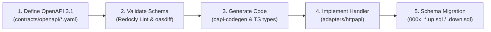

# DengueSense Backend & Contract-First Development

This skill defines the contract-first engineering discipline for DengueSense's Go 1.24 microservices architecture (`backend/services/`) and shared OpenAPI specifications (`contracts/`).

## Architectural Principle: Contract-First



---

## 1. OpenAPI Modification Workflow

Never write Go server handlers or frontend API calls before the contract is finalized.

1. **Edit the Contract**: Modify the relevant OpenAPI specification:
   - Public gateway API: `contracts/openapi/public-v1.yaml`
   - Workflow service: `contracts/openapi/workflow-internal.yaml`
   - GenAI service: `contracts/openapi/genai-internal.yaml`
   - Surveillance service: `contracts/openapi/surveillance-internal.yaml`
2. **Lint the Spec**:
   ```powershell
   cd contracts
   npx --yes @redocly/cli@2 lint
   ```
3. **No Breaking Changes**:
   - Never remove or rename an existing required field on a published endpoint.
   - For backwards-incompatible changes, introduce new endpoints or version paths (`/v2/`).

---

## 2. Go Microservices Clean Architecture

Each microservice in `backend/services/<name>/` strictly follows hexagonal architecture:

```text
backend/services/<service>/
├── domain/            # Pure enterprise logic, models, repository interfaces (zero external deps)
├── app/               # Application use cases, service orchestrators
├── adapters/          # I/O implementations
│   ├── httpapi/       # Gin HTTP handlers, request validation, RFC 7807 problem details
│   ├── postgres/      # SQL queries, pgx connection pooling, dbx transactions
│   └── memory/        # In-memory repository doubles for fast unit testing
└── migrations/        # golang-migrate up/down SQL scripts
```

### Immutable Snapshots Rule
- When an allocation plan or dispatch draft is generated, it captures an immutable snapshot of all inputs (e.g. `estimated_cases_prevented`, `items`, `citations`).
- Subsequent edits create new versions; they must **never** mutate previously confirmed and signed snapshots in place.

---

## 3. Database Migrations Discipline

1. **File Naming**: Sequential 4-digit prefix with explicit up and down scripts:
   - `0004_allocation_plan_confirmation.up.sql`
   - `0004_allocation_plan_confirmation.down.sql`
2. **Idempotency & Safety**:
   - Always write `CREATE TABLE IF NOT EXISTS` or `ADD COLUMN IF NOT EXISTS`.
   - Never leave a migration without a matching rollback script in `.down.sql`.
   - Use transactions (`BEGIN; ... COMMIT;`) in all migration files.

---

## 4. RFC 7807 Problem Details Error Handling

All error responses from HTTP handlers must conform to `application/problem+json`:

```json
{
  "type": "https://denguesense.vn/errors/guardrail-blocked",
  "title": "Dự thảo không đạt kiểm tra tự động",
  "status": 422,
  "code": "genai.guardrail_blocked",
  "detail": "Văn bản trích dẫn không thuộc danh mục đã kiểm chứng."
}
```

See [Contract-First Guide & Migration Runbook](./references/contract_first_guide.md) for full instructions.
