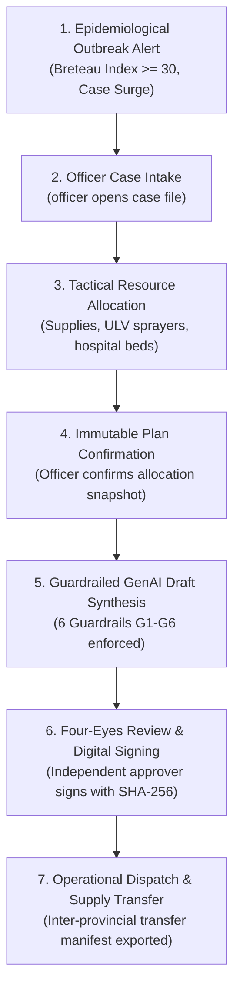

# DengueSense Closed-Loop E2E Workflows & Persona Testing

This skill guides the execution, testing, and live demonstration of the end-to-end operational workflow in DengueSense, ensuring seamless integration between all personas, services, and regulatory guardrails.

## The Closed-Loop Surveillance & Response Lifecycle

---

## 1. Persona Access Control (RBAC) Matrix

| Persona | Role Key | Default Username / Password | Capabilities & Permissions |
|---|---|---|---|
| **Cán bộ Dịch tễ** | `officer` | `officer` / `officer123` | Triage alerts, open cases, draft allocation plans, confirm plan snapshot, trigger GenAI draft. **Cannot approve own draft**. |
| **Lãnh đạo Phê duyệt** | `approver` | `approver` / `approver123` | Review B2G dispatches, inspect guardrails & citations, approve with digital signature, reject with reason. |
| **Chuyên viên Phân tích** | `analyst` | `demo.phan-tich` / `phantich123` | Run Layer 1 prediction runs, analyze SHAP feature importance, adjust conformal intervals, compare S1/S2/S3 scenarios. |
| **Người xem** | `viewer` | `demo.xem` / `xem123` | Read-only access to risk map and model transparency page. All operational buttons hidden. |

---

## 2. 7-Step Demonstration & Validation Walkthrough

1. **Step 1: View Outbreak Risk Map (`/app`)**:
   - Log in as `officer`.
   - Inspect choropleth map of Vietnam's 34 provinces. Identify high-risk red zones (e.g. Hà Nội, TP. Hồ Chí Minh).
2. **Step 2: Alert Triage (`/app/alerts`)**:
   - Filter active alerts. Select alert triggered by Breteau Index $BI \ge 30$.
   - Click "Tiếp nhận cảnh báo" $\to$ Status changes from `open` to `closed`.
3. **Step 3: Open Case File (`/app/cases`)**:
   - Click "Lập hồ sơ xử lý" $\to$ Creates new case file tied to the alert ID.
4. **Step 4: Create & Confirm Allocation Plan**:
   - Open case detail view. Click "Lập phương án phân bổ".
   - Input logistics requirements (ULV sprayers, chemical liters, test kits).
   - Click "Xác nhận phương án" $\to$ Triggers `POST /plans/{id}/confirm`. Status becomes `confirmed`.
5. **Step 5: Synthesize GenAI Dispatch**:
   - Click "Tạo dự thảo B2G".
   - GenAI validates G1-G6 guardrails and embeds verified legal citations (QĐ 3711, QĐ 02, NĐ 30).
   - Generated draft appears with unapproved watermark `MÔ PHỎNG CUỘC THI - CHƯA KÝ`.
6. **Step 6: Four-Eyes Principle Review & Digital Signature**:
   - Log out and log in as `approver`.
   - Open draft detail page (`/app/cases/{id}/drafts/{draftId}`).
   - Verify guardrail table and legal citations.
   - Click "Phê duyệt & Ký số" $\to$ Enters simulated digital certificate $\to$ Status becomes `approved`.
7. **Step 7: Inter-Provincial Transfer Manifest**:
   - Open "Điều phối vật tư liên tỉnh" modal.
   - Export CSV manifest for supply transfers between surplus and deficit provinces.

See [Detailed Persona Journey Guide](./references/persona_journeys.md) for full walkthrough script.
