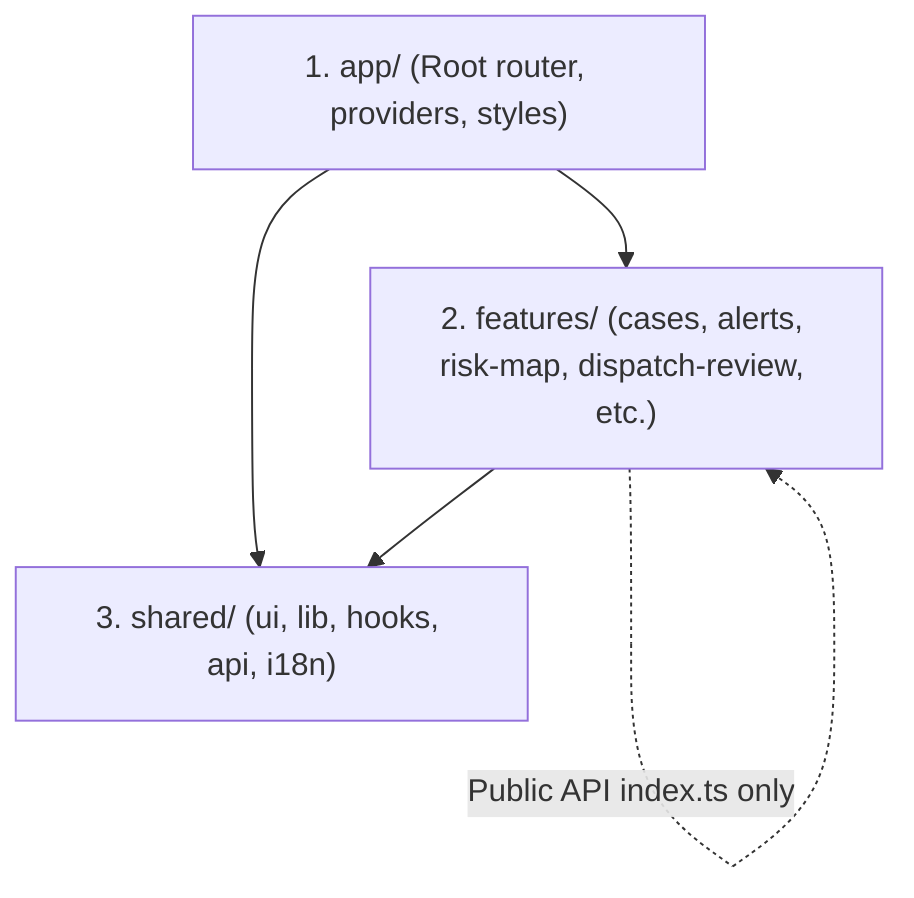

# DengueSense Frontend — Feature-Sliced Design (FSD) & React 19

This skill governs the development of the DengueSense interactive dashboard (`dashboard/src/`), strictly enforcing Feature-Sliced Design (FSD) architectural boundaries, strict TypeScript imports, and accessibility.

## Layer Hierarchy & Boundary Rules



### The 3 Core Rules Enforced by Dependency Cruiser
1. **No Upward Imports**: A lower layer may NEVER import from a higher layer:
   - `shared/` must NEVER import anything from `features/` or `app/`.
   - `features/` must NEVER import anything from `app/`.
2. **Cross-Feature Imports**: Slices within `features/` may only import from another feature's public barrel file (`features/<slice>/index.ts`). Never import deep paths like `features/alerts/components/AlertModal`.
3. **Verification**: Always run `npm --prefix dashboard run depcruise` before submitting code.

---

## 1. Strict TypeScript Conventions

### `verbatimModuleSyntax` Rule
Because TypeScript's `verbatimModuleSyntax` is enabled in `tsconfig.json`:
- **Always** use `import { type MyType }` for type-only imports.
- Never use `import { MyType }` when `MyType` is purely a type or interface, as it causes compilation failures.

```typescript
//  Correct
import { useState, useMemo } from 'react'
import { type ProvinceRisk, type AlertSummary } from '@/shared/api/schema.gen'

//  Wrong — causes TS1484 error
import { ProvinceRisk, AlertSummary } from '@/shared/api/schema.gen'
```

---

## 2. React 19 Rules of Hooks

In React 19, hooks must execute in the exact same order on every render:
1. **Declare all hooks unconditionally** at the very top of the functional component.
2. **Never** place `useMemo`, `useEffect`, `useCallback`, or custom hooks after an early `if (loading) return` or `if (error) return` check.

```typescript
//  Correct: Hooks first, then conditional returns
export function CaseDetailView({ caseId }: { caseId: string }) {
  const [activeTab, setActiveTab] = useState<'info' | 'dispatch'>('info')
  const { data: caseData, isLoading } = useCaseQuery(caseId)
  
  const stats = useMemo(() => {
    return computeStats(caseData)
  }, [caseData])

  if (isLoading) return <LoadingSpinner />
  if (!caseData) return <NotFound />

  return <div>...</div>
}
```

---

## 3. Mock Service Worker (MSW) & Testing Pattern

When adding or modifying API interactions:
1. Update mock endpoints in `dashboard/src/mocks/handlers.ts`.
2. Add mock data fixtures in `dashboard/src/mocks/workflowFixtures.ts`.
3. Write test cases in `feature.test.tsx` using Vitest and `@testing-library/react`.

```powershell
cd dashboard
# Run single test file
npx vitest run src/features/cases/cases.test.tsx

# Run entire test suite
npm test
```

See [FSD Architecture & Dependency Rules](./references/fsd_rules.md) for full layer specifications.
