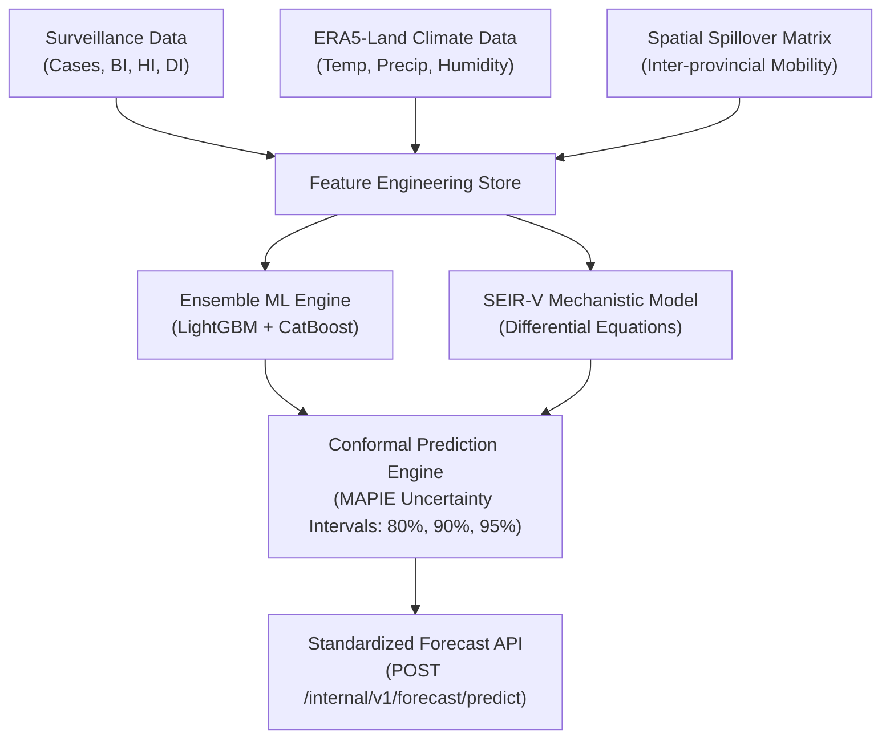

# DengueSense Layer 1 — Outbreak Forecasting & SEIR-V Modeling

This skill provides comprehensive instructions for maintaining, training, and validating DengueSense's predictive modeling layer across Vietnam's 34 provinces/cities.

## Layer 1 Architecture



---

## 1. Key Modeling Components

### A. Machine Learning Ensemble
- **Algorithms**: LightGBM Regressor and CatBoost Regressor trained on 10+ years of monthly provincial epidemiology data.
- **Validation Scheme**: **Strict temporal walk-forward split** (expanding window). Random cross-validation or future leakage is strictly prohibited in epidemiology evaluation.
- **Evaluation Metrics**:
  - MAE (Mean Absolute Error)
  - RMSE (Root Mean Squared Error)
  - Pinball Loss (Quantile coverage for prediction intervals)
  - Outbreak Detection F1-Score (Threshold at 90th historical percentile)

### B. SEIR-V Mechanistic Model
- Coupled Ordinary Differential Equations (ODEs) modeling human transmission and mosquito vector dynamics:
  - Humans: $S_h \to E_h \to I_h \to R_h$
  - Vectors (*Aedes aegypti* / *albopictus*): $S_v \to E_v \to I_v$
- Temperature-dependent biting rate $a(T)$, extrinsic incubation period $EIP(T)$, and mosquito mortality $\mu_v(T)$.

### C. Conformal Prediction (Uncertainty Quantification)
- Provides mathematically guaranteed coverage intervals:
  - $\alpha = 0.20 \implies 80\%$ prediction interval
  - $\alpha = 0.10 \implies 90\%$ prediction interval
  - $\alpha = 0.05 \implies 95\%$ prediction interval
- Never display a single deterministic point forecast to decision-makers without its calibrated conformal band and historical baseline comparison.

---

## 2. Feature Store & Climate Preprocessing

1. **ERA5-Land Raster Processing**:
   - Monthly aggregate rasters of Land Surface Temperature ($T_{min}, T_{mean}, T_{max}$), total precipitation, and relative humidity.
   - Zonal statistics computed per province using official 34-province administrative boundaries.
2. **Lagged Features**:
   - Dengue transmission dynamics require 1-month, 2-month, and 3-month lags corresponding to vector breeding and incubation cycles.
3. **Breteau Index (BI) & Thermal Triggers**:
   - $BI \ge 30$: High outbreak risk trigger (QĐ 3711/QĐ-BYT).
   - Sustained temperature $> 28^\circ\text{C}$ + high humidity $> 80\%$: Vector amplification trigger.

For detailed schemas, see:
- [Model Architecture & Calibration Protocol](./references/model_architecture.md)
- [Climate Features & Zonal Statistics](./references/climate_features.md)

---

## 3. Running & Testing Forecast Pipelines

```powershell
cd ai-service

# Run all epidemiological & forecast tests
.\venv\Scripts\pytest -q tests/test_data/ tests/test_models/

# Run single pipeline validation
.\venv\Scripts\python -m app.pipelines.forecast_pipeline --province ha_noi --horizon 3
```
