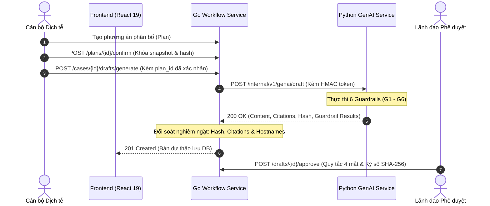

# DengueSense Layer 3 — Guardrailed GenAI & B2G Digital Workflow

This skill guides the implementation, testing, and compliance verification of DengueSense's regulatory-compliant GenAI dispatch drafting engine (B2G - Business-to-Government and B2B).

## Architectural Flow



---

## 1. The 6 Automated Guardrails (G1 - G6)

Every draft generation request must pass 6 non-bypassable guardrail gates before storage:

| Gate | Code | Purpose | Pass Criteria |
|---|---|---|---|
| **G1** | Data Consistency | Prevents hallucinated epidemic numbers | Numbers strictly sourced from confirmed allocation plan snapshot and case alert parameters. |
| **G2** | Administrative Boundary | Validates Vietnamese administrative entities | Province codes matched against `province_metadata.csv` (34 provinces). |
| **G3** | Legal Citations | Eliminates hallucinated laws & circulars | Exact document ID lookup against pre-verified legal repository. Verbatim quote match. |
| **G4** | Administrative Format | Conforms to Decree 30/2020/NĐ-CP | Requires standardized header, body, recipient sections; watermark "MÔ PHỎNG CUỘC THI - CHƯA KÝ". |
| **G5** | Medical Safety | Clinical boundary protection | Zero prescription advice, zero specific drug dosages, zero unauthorized medical diagnoses. |
| **G6** | Length & Tone | Administrative compliance | Content length within 80 - 5000 characters; formal Vietnamese administrative tone. |

See [Guardrail Detailed Specifications](./references/guardrail_specs.md) for full rules.

---

## 2. Legal Citation Guardrail (G3) Rules

Under no circumstances should the backend or AI service allow dynamic, unverified citations in B2G dispatches:

1. **Exact Document ID Lookup**:
   - Must use exact map lookup: `rule, ok := knownLegalCitations[docID]`.
   - **Never** use substring heuristics (`strings.Contains(docID, "3711")` is strictly prohibited). Counterfeit IDs like `vn-custom-3711` must return HTTP 502.
2. **Official Document IDs & Clauses**:
   - `vn-moh-qd3711-2014`: Quyết định 3711/QĐ-BYT (Phần III — Giám sát véc tơ truyền bệnh & Ngưỡng nguy cơ cao $\ge$ 30).
   - `vn-qd02-2016`: Quyết định 02/2016/QĐ-TTg (Điều 2, Khoản 2, Điểm a — Điều kiện công bố dịch bệnh truyền nhiễm).
   - `vn-nd30-2020`: Nghị định 30/2020/NĐ-CP (Điều 5, Khoản 1 — Giá trị pháp lý của văn bản điện tử ký số).
3. **URL Hostname Whitelist**:
   - Hostname must be parsed via standard URL parser (`url.Parse` in Go / `urllib.parse` in Python).
   - Only exact domain matches or subdomains of authorized government domains: `congbao.chinhphu.vn`, `kcb.vn`, `moh.gov.vn`, `vanban.chinhphu.vn`, `vbpl.moj.gov.vn`.

See [Legal Citations Repository](./references/legal_citations.md) for verbatim quotes.

---

## 3. Four-Eyes Principle (Quy tắc 4 Mắt)

- **Author $\ne$ Approver**: The officer who triggers the draft creation (`created_by`) is strictly forbidden from approving or signing the draft.
- **Workflow Enforcement**:
  ```go
  if draft.CreatedBy == currentUserID {
      return errors.New("4-eyes principle violation: creator cannot approve draft")
  }
  ```
- **Digital Signature**: The approver's identity, timestamp, and SHA-256 hash of the final content are immutably signed and stored in the database audit record.

---

## 4. Verification & Testing

Always verify Layer 3 changes using:

```powershell
# 1. AI-Service Unit & Contract Tests
cd ai-service
.\venv\Scripts\pytest -v tests/test_serving/test_genai_api.py

# 2. Workflow Backend Citation & Guardrail Tests
cd ..\backend\services\workflow\adapters\httpapi
go test -v -run "TestValidCitations|TestGenerateDraft" .
```
