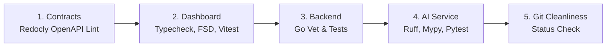

# DengueSense Monorepo Quality Gate

This skill provides a standardized, automated runbook to verify and enforce code quality, architectural constraints, and test suites across the DengueSense monorepo prior to committing changes or merging PRs.

## Overview & Execution Order

The quality gate must be executed in order of dependency:



---

## Step-by-Step Verification Procedure

### Gate 1: OpenAPI Contracts Validation
Ensures shared API specifications adhere to standards and contain no syntax or breaking schema violations.

```powershell
# From repo root
cd contracts
npx --yes @redocly/cli@2 lint
cd ..
```
- **Pass Criteria**: `Woohoo! Your API descriptions are valid.` (Exit code 0).
- **If Failed**: Inspect `contracts/openapi/*.yaml` against [Redocly rules](file:///d:/Cu%E1%BB%99c%20thi/DengueSense/contracts/redocly.yaml).

### Gate 2: Frontend Dashboard Quality Gate
Verifies TypeScript strict type safety, Feature-Sliced Design (FSD) architecture boundaries, and unit/integration tests.

```powershell
cd dashboard
# 1. Typecheck & FSD Boundaries
npm run typecheck
npm run depcruise

# 2. Vitest Suite (All 249 tests across 44 suites)
npm test

# 3. Linter
npm run lint
cd ..
```
- **Crucial Rules**:
  - `verbatimModuleSyntax` is enabled: always use `import { type Foo }` for type imports.
  - `shared/` must never import from `features/` or `app/`.
  - React 19 hooks must be called unconditionally before any early returns.

### Gate 3: Go Backend Microservices Gate
Runs static analysis and Go test suites across all 5 microservices (`gateway`, `identity`, `surveillance`, `workflow`, `notification`).

```powershell
cd backend
go vet ./...
go test -v ./...
cd ..
```
- **Pass Criteria**: All packages exit with `ok` or `[no test files]`. Zero test failures.
- **Key Modules**:
  - Workflow draft generation and legal citation verification: `backend/services/workflow/adapters/httpapi`
  - Gateway routing and JWT validation: `backend/services/gateway/...`

### Gate 4: Python AI Service Gate
Validates Python code formatting, type annotations, and test suite for forecasting & GenAI endpoints.

```powershell
cd ai-service
# 1. Static Analysis
.\venv\Scripts\ruff check app tests
.\venv\Scripts\ruff format --check app tests
.\venv\Scripts\mypy app

# 2. Pytest Suite (All 515+ tests)
.\venv\Scripts\pytest -q
cd ..
```
- **Pass Criteria**: All pytest assertions pass without error.

---

## One-Click Automation Scripts

To run all gates in a single automated pass with colored summary logs:

- **Windows PowerShell**:
  ```powershell
  .\skills\denguesense-quality-gate\scripts\run_all_checks.ps1
  ```
- **Linux / macOS / Git Bash**:
  ```bash
  ./skills/denguesense-quality-gate/scripts/run_all_checks.sh
  ```

---

## Failure Recovery & Runbook

For detailed error diagnosis, common CI/CD failure scenarios, and quick fixes, refer to:
- [Quality Gate Matrix & Troubleshooting](./references/quality_matrix.md)
