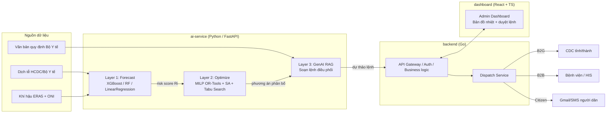

# DengueSense

> **Nền tảng AI hỗ trợ ra quyết định y tế công cộng khép kín cho sốt xuất huyết:** Cảnh báo sớm dịch 1–6 tháng với độ chính xác 89.5%, tối ưu hóa phân bổ nguồn lực khẩn cấp (MILP), và tự động soạn thảo công điện điều phối tuân thủ Nghị định 30/2020/NĐ-CP & Quyết định 02/2016/QĐ-BYT với Guardrail G1 khóa cứng số liệu chống ảo giác (Zero-Hallucination).
>
> 🏆 **Đội thi MedSentinel** — Cuộc thi Sáng tạo Trẻ 2026  
> 🚀 **Trải nghiệm trực tuyến (Live Demo):** [https://denguesense.vercel.app/](https://denguesense.vercel.app/)  
> 🔑 **Tài khoản dùng thử nhanh:** Đã tích hợp sẵn nút đăng nhập 1-click *(Khách tham quan / Ban Giám Khảo, Chuyên viên CDC, Lãnh đạo Sở)* ngay tại giao diện đăng nhập.

## 1. Tổng quan & Kiến trúc 3 Lớp AI Đột phá

DengueSense chuyển quy trình phòng chống sốt xuất huyết từ **ứng phó bị động** sang **chủ động đón đầu dịch bệnh**, khép kín qua 3 tầng công nghệ lõi:

1. **Layer 1: Dự báo dịch tễ không - thời gian (Spatio-Temporal AI):**
   - Mô hình tổ hợp **M4-R2** (XGBoost + Random Forest) tích hợp dữ liệu viễn thám khí hậu toàn cầu **ERA5** (nhiệt độ, lượng mưa, độ ẩm tích lũy) và độ trễ dịch tễ học.
   - **Độ chính xác cảnh báo dịch đạt 89.5%**, dự báo trước **1–6 tháng** trên **34 tỉnh/thành phố** trọng điểm dịch tại Việt Nam.
2. **Layer 2: Tối ưu hóa phân bổ nguồn lực can thiệp (MILP & Metaheuristics):**
   - Ứng dụng quy hoạch nguyên hỗn hợp (**Google OR-Tools CP-SAT**) giải bài toán tối ưu lợi ích biên giảm dần trong **dưới 1 phút**.
   - Tự động lập kế hoạch phân bổ tối ưu **3 trụ cột thiết yếu**: **Giường bệnh** (chống quá tải hồi sức), **Vật tư y tế & Hóa chất** (Cloramin B, máy phun công suất cao, test nhanh), và **Đội phản ứng nhanh** (hỗ trợ thực địa xử lý ổ bọ gậy) dưới ràng buộc ngân sách và sàn công bằng.
3. **Layer 3: Trợ lý soạn thảo công điện GenAI & Chuẩn thể thức hành chính:**
   - Ứng dụng mô hình RAG sinh dự thảo công điện khẩn (B2G gửi Ban Chỉ đạo/Sở Y tế) và báo cáo điều trị (B2B gửi Bệnh viện) tuân thủ nghiêm ngặt **Nghị định số 30/2020/NĐ-CP** và **Quyết định số 02/2016/QĐ-BYT**.
   - Tích hợp **Guardrail G1 (Strict Data Locking / Zero-Hallucination)** khóa cứng 100% số liệu dự báo và phân bổ, ngăn chặn triệt để ảo giác AI; vận hành theo cơ chế **Human-in-the-loop** (quy tắc 4 mắt: chuyên viên soạn, lãnh đạo duyệt) và hỗ trợ **In / Xuất PDF khổ A4 hành chính**.


## 2. Kiến trúc hệ thống



`backend` chỉ gọi `ai-service` qua REST nội bộ (JSON/OpenAPI) — không gọi thẳng model từ frontend, không để Go tự implement lại logic ML/optimize.

## 3. Tech stack đã chốt

| Lớp | Công nghệ | Lý do chọn |
|---|---|---|
| Backend / API / Dispatch | **Go** + Gin | Hiệu năng cao, phù hợp người phụ trách fullstack/devops, dễ deploy binary gọn |
| AI Service (Forecast + Optimize + RAG) | **Python** + FastAPI | Hệ sinh thái ML/optimize (XGBoost, OR-Tools, LangChain) chỉ mature ở Python; FastAPI tự sinh OpenAPI spec cho Go gọi vào |
| Forecast (Layer 1) | XGBoost, scikit-learn (RandomForest, LinearRegression), pandas, TimeSeriesSplit | Đúng như đã báo cáo, không đổi |
| Optimize (Layer 2) | Google **OR-Tools** (MILP/CP-SAT) + Simulated Annealing/Tabu Search tự viết (numpy) | OR-Tools là chuẩn công nghiệp cho MILP, free, Python-first |
| GenAI RAG (Layer 3) | LangChain (hoặc llama-index) + **pgvector** trên Postgres, LLM qua API (Claude/OpenAI, cấu hình qua `.env`) | Dùng chung 1 Postgres cho cả geo-data và vector-store thay vì thêm 1 DB riêng → giảm chi phí vận hành, đúng tinh thần "chi phí thấp" của đề án |
| Frontend | React + TypeScript + Vite, TailwindCSS, Leaflet (bản đồ nhiệt), Framer Motion, TanStack Query, Zustand | Đúng như đã báo cáo; Zustand thay Redux vì team nhỏ, ít boilerplate |
| Database | **PostgreSQL + PostGIS** (geo theo quận/huyện) + pgvector (RAG) | 1 DB duy nhất cho MVP, giảm số service phải vận hành |
| Cache / Queue | Redis — **chỉ thêm khi vào giai đoạn pilot/scale**, MVP chưa cần | Tránh over-engineering cho bản demo/pilot đầu |
| Auth | JWT (access/refresh), OAuth2 cho tích hợp HIS sau này | Theo đúng phương án giảm rủi ro bảo mật đã cam kết trong đề án |
| Hạ tầng | Docker + Docker Compose (dev/pilot), GitHub Actions CI, 1 VM Cloud (AWS/GCP) cho pilot 2 tỉnh | Portable, không cần Kubernetes ở giai đoạn MVP/pilot |
| Data pipeline & fallback | Cron job (Python) kéo ERA5 + báo cáo ca bệnh; ARIMA nội suy khi mất kết nối | **Roadmap giai đoạn 2**, không chặn MVP |

**Nguyên tắc chọn stack:** ưu tiên công nghệ cả 2 bạn tech đã có sẵn kinh nghiệm (Go/React/DevOps + AI Agent/Python), tối thiểu số service phải vận hành, và không thêm hạ tầng nào chưa cần dùng ngay ở MVP.

## 4. Cấu trúc thư mục (monorepo)

```
DengueSense/
├── backend/            # Go: API gateway, auth, dispatch, business logic
├── ai-service/         # Python: forecast (Layer 1), optimize (Layer 2), GenAI RAG (Layer 3)
├── dashboard/           # React + TS + Vite: Admin Dashboard
├── infra/                # docker-compose, deploy scripts, env templates
├── docs/                  # ⭐ phương pháp luận: dữ liệu, mô hình, thực nghiệm
├── .github/
│   ├── workflows/         # CI cho từng service
│   └── pull_request_template.md
├── CONTRIBUTING.md         # quy tắc code & git — đọc trước khi PR
└── README.md
```

Mỗi thư mục service có README riêng mô tả cách chạy local — xem [backend/README.md](backend/README.md), [ai-service/README.md](ai-service/README.md), [dashboard/README.md](dashboard/README.md).

## 5. Bắt đầu nhanh (Khởi chạy & Kiểm thử MVP v1.0)

Toàn bộ hệ thống Backend, Database, Message Bus và Web Console Frontend đã được đóng gói Docker hoàn chỉnh.

### Bước 1: Khởi động toàn bộ cụm dịch vụ

```bash
# 1. Chuẩn bị file cấu hình môi trường nếu chạy lần đầu
cp infra/.env.example infra/.env

# 2. Khởi chạy toàn bộ 11 container (Postgres, NATS, Gateway, Identity, Surveillance, Forecast, Workflow, Notification, Optimize, GenAI, Dashboard)
docker compose -f infra/docker-compose.yml -f infra/docker-compose.dev.yml up -d
```

### Bước 2: Nạp tài khoản kiểm thử (Idempotent)

```bash
# Trên Linux / macOS / Git Bash:
bash infra/scripts/seed-users.sh

# Trên Windows PowerShell:
powershell -ExecutionPolicy Bypass -File infra/scripts/seed-users.ps1
```

### Bước 3: Truy cập & Trải nghiệm

- **Web Console (Docker):** [http://127.0.0.1:3000](http://127.0.0.1:3000)
- **Hoặc chạy Frontend trực tiếp (HMR Dev Mode):**
  ```bash
  cd dashboard
  npm run dev   # Mở http://127.0.0.1:5173
  ```

| Vai trò | Tên đăng nhập | Mật khẩu | Chức năng thử nghiệm |
|---|---|---|---|
| **Ban Giám Khảo & Khách (Guest)** | *Bấm nút "Khách tham quan"* | *(Đăng nhập ngay)* | Xem toàn bộ Dashboard, bản đồ GIS 34 tỉnh, chỉ số mô hình học máy |
| **Cán bộ điều hành (Officer)** | `officer@denguesense.vn` hoặc `officer` | `officer123456` | Tiếp nhận cảnh báo, tạo hồ sơ, tối ưu phân bổ nguồn lực (MILP), sinh dự thảo AI (L3) |
| **Lãnh đạo phê duyệt (Approver)** | `approver@denguesense.vn` hoặc `approver` | `approver123456` | Thẩm định 4 mắt (Four-eyes check), kiểm tra Guardrails G1–G6, phê duyệt & **In / Xuất PDF** |
| **Chuyên viên phân tích (Analyst)** | `dev-analyst` | `ujMOTLmI2sRHa7X-oN7L9oky` | Xem & kích hoạt mô hình dự báo M4-R2 |
| **Người xem (Viewer)** | `dev-viewer` | `a6BlIE3BM_whDmzRPxIbMK6O` | Xem bản đồ rủi ro & số liệu dịch tễ |


## 5b. Deploy prototype (Vercel)

`dashboard/` là prototype trực quan (chi tiết cái gì thật/cái gì minh hoạ: [dashboard/README.md](dashboard/README.md)). Deploy lên Vercel:

1. Đăng nhập [vercel.com](https://vercel.com) bằng GitHub
2. **Add New → Project → Import** repo `DengueSense`
3. Ở bước cấu hình: **Root Directory** đổi thành `dashboard` (bấm Edit cạnh Root Directory)
4. Framework Preset: Vercel tự nhận diện **Vite** — để mặc định (Build: `npm run build`, Output: `dist`)
5. **Deploy**

Không cần biến môi trường nào — toàn bộ dữ liệu là file JSON tĩnh trong `dashboard/public/data/`. Mỗi lần push nhánh này lên GitHub, Vercel tự build lại và cập nhật link.

## 6. Quy tắc làm việc & đóng góp code

**Đọc [CONTRIBUTING.md](CONTRIBUTING.md) trước khi tạo branch/PR đầu tiên** — quy tắc git, coding convention, CI.

## 6b. Phương pháp luận kỹ thuật ⭐

Trước khi bắt tay vào dữ liệu hoặc train model, đọc bộ tài liệu trong **[docs/](docs/README.md)**:

| # | Tài liệu | Nội dung |
|---|---|---|
| 00 | [Review hiện trạng](docs/00-review-hien-trang.md) | Rà soát đề án: rủi ro, mâu thuẫn số liệu cần sửa |
| 01 | [Chiến lược dữ liệu](docs/01-chien-luoc-du-lieu.md) | Nguồn dữ liệu, chuẩn hoá ranh giới hành chính, chia tập, chống rò rỉ |
| 02 | [Phương pháp mô hình](docs/02-phuong-phap-mo-hinh.md) | 4 baseline + 10 model, 4 phương pháp tuning, ensemble, metric, cổng quyết định |
| 03 | [Quy trình thực nghiệm](docs/03-quy-trinh-thuc-nghiem.md) | Đánh số thí nghiệm, MLflow tracking, tái lập, quy tắc dùng tập test |
| 04 | [Phương pháp tối ưu](docs/04-phuong-phap-toi-uu.md) | Formulation, so sánh 5 solver, đánh giá dưới bất định |
| 05 | [Phương pháp GenAI RAG](docs/05-phuong-phap-genai-rag.md) | Kiến trúc RAG, guardrail, bộ đánh giá |
| 06 | [**Khảo sát tài liệu & Định vị khác biệt**](docs/06-khao-sat-tai-lieu.md) | ⭐ Benchmark thật (D-MOSS, EWARS, PLOS NTD), 5 khác biệt K1–K5, chốt model & tuning |
| 07 | [**Model Card — Layer 1**](docs/07-model-card.md) | ⭐ Hiệu năng đo được, độ vững, SHAP, **12 giới hạn đã biết có số đo**, khuyến nghị vận hành (mọi con số có nguồn experiment) |
| 08 | [**Bàn giao Layer 1**](docs/08-ban-giao-layer1.md) | ⭐ Tổng kết đầy đủ để đồng đội tiếp nhận: bản đồ code, kỷ luật đánh giá, 15 thí nghiệm, hướng đã thất bại, ý tưởng chưa thử |
| 09 | [**Kiến trúc hệ thống & Backend**](docs/09-kien-truc-backend.md) | ⭐ Microservice: danh mục service, hợp đồng API/sự kiện, dữ liệu, bảo mật, observability, CI/CD, quy trình, kế hoạch theo đợt |
| 10 | [**Kiến trúc Frontend**](docs/10-kien-truc-frontend.md) | ⭐ Kiến trúc dashboard, luật trình bày số liệu trung thực (T1–T10), a11y, hiệu năng, test, quy trình |

Ba nguyên tắc xuyên suốt: **không có baseline thì không có kết quả** · **tập test chỉ chạm một lần** · **số nào đưa vào hồ sơ thì phải chạy lại được**.

## 7. Theo dõi tiến độ

> 🔴 **Đang làm:** Phase 1 — hoàn thiện tầng dữ liệu (21/09 → 12/10/2026).
> Checklist thi hành hằng ngày: **[PHASE-1-CHECKLIST.md](PHASE-1-CHECKLIST.md)**

| Phase | Thời gian | Trọng tâm | Trạng thái |
|---|---|---|---|
| 0 — Solo Bootstrap | — | Backend, FastAPI, infra | ⏸️ Hoãn có chủ đích → gộp vào Phase 5 |
| **1 — Dữ liệu** | **21/09 – 12/10/2026** | **Khí hậu, dân số, splits, baseline** | 🔴 **Đang làm (~40%)** |
| 2 — Mô hình Layer 1 | 13/10 – 22/11/2026 | 4 model Tier 1, tuning, ensemble | ⏳ Chờ |
| 3 — Tối ưu Layer 2 | 23/11 – 13/12/2026 | MILP, đánh giá dưới bất định | ⏳ Chờ |
| 4 — GenAI RAG Layer 3 | 14/12/2026 – 31/01/2027 | Guardrail, bộ vàng | ⏳ Chờ |
| 5 — Tích hợp & Pilot | 01/02 – 15/03/2027 | Backend, dispatch, bảo mật | ⏳ Chờ |
| 6 — Pilot thực địa | Q2/2027 | 1-2 bệnh viện/CDC, case study | ⏳ Chờ |

Danh sách task chi tiết theo từng phase (có checkbox, phân owner): xem **[ROADMAP.md](ROADMAP.md)**.

Dùng **GitHub Issues + Projects (Kanban)** cho task lớn, không theo dõi qua chat để tránh thất lạc.

Mỗi issue gắn nhãn `backend` / `ai-service` / `dashboard` / `infra` và milestone tương ứng; PR phải link issue (`closes #x`).

## 8. Team Tech

| Thành viên | Vai trò | Mảng phụ trách |
|---|---|---|
| Nguyễn Đào Nam Hải | Tech Lead | Fullstack, DevOps, AI Agent, Computer Vision — chủ trì `backend`, `infra`, kiến trúc chung |
| Đồng Minh Dương | AI/ML Engineer | AI Agent, Y sinh — chủ trì `ai-service` (Layer 1/2/3) |
