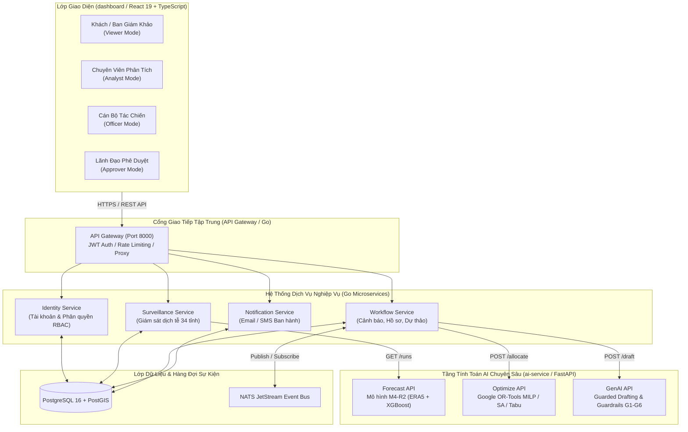

# DengueSense — Nền Tảng Giám Sát & Ra Quyết Định Dịch Tễ Sốt Xuất Huyết Thông Minh

[](https://github.com/NamHaiIT2HUST/DengueSense/actions/workflows/ci-dashboard.yml)
[](https://denguesense.vercel.app/)
[](https://www.typescriptlang.org/)
[](https://go.dev/)
[](https://fastapi.tiangolo.com/)
[](LICENSE)

> **Giải pháp Y tế Công cộng Khép kín Chuyển đổi Số:** Cảnh báo sớm dịch sốt xuất huyết trước 1–6 tháng bằng mô hình học máy không - thời gian kết hợp dữ liệu viễn thám toàn cầu ECMWF ERA5; tự động tối ưu hóa phân bổ nguồn lực y tế bằng quy hoạch nguyên hỗn hợp (MILP); và trợ lý GenAI tự động soạn thảo công điện chỉ đạo cấp bách tuân thủ Nghị định 30/2020/NĐ-CP với 6 lớp kiểm soát tự động Guardrails G1–G6 nhằm khóa cứng số liệu và đối chiếu danh mục căn cứ pháp lý đã kiểm chứng.
>
> 🏆 **Đội thi MedSentinel** — Trường Công nghệ Thông tin & Truyền thông, Trường Điện - Điện tử, Trường Cơ khí — **Đại học Bách khoa Hà Nội (HUST)**  
> 🌐 **Live Demo Hệ Thống:** [https://denguesense.vercel.app/](https://denguesense.vercel.app/)  
> 📄 **Cẩm nang kiểm thử PDF theo Role:** Xem file [`Huong_Dan_Su_Dung_Va_Kiem_Thu_DengueSense_Theo_Role.pdf`](Huong_Dan_Su_Dung_Va_Kiem_Thu_DengueSense_Theo_Role.pdf) tại thư mục gốc dự án.

---

## 1. Vấn Đề Thực Tiễn & Tầm Nhìn Dự Án

Sốt xuất huyết Dengue (SXH) là bệnh truyền nhiễm lưu hành hàng năm tại Việt Nam với hơn 100.000 ca mắc và hàng chục ca tử vong mỗi đợt dịch lớn. Công tác phòng chống dịch truyền thống hiện đang đối mặt với 3 "nút thắt cổ chai" mang tính hệ thống:

1. **Ứng phó thụ động do thiếu dự báo sớm:** Dịch tễ chỉ được phát hiện khi số ca đã tăng vọt tại cơ sở y tế (độ trễ 2–4 tuần).
2. **Lãng phí & xung đột nguồn lực khi phân bổ:** Thiếu công cụ toán học tối ưu, việc phân bổ giường bệnh, hóa chất diệt muỗi Cloramin B và đội phản ứng nhanh thường dàn trải hoặc quá chậm so với đà bùng phát.
3. **Độ trễ hành chính trong ban hành văn bản chỉ đạo:** Quy trình từ khi phát hiện ổ dịch đến khi ban hành văn bản chỉ đạo B2G mất từ 3–7 ngày làm việc qua nhiều cấp phê duyệt.

**DengueSense** được phát triển nhằm giải quyết triệt để 3 thách thức trên thông qua **Kiến trúc Khép kín 3 Tầng (Closed-Loop Framework)**: *Dự báo sớm $\rightarrow$ Tối ưu phân bổ $\rightarrow$ Tự động hóa điều phối có kiểm soát*.

---

## 2. Kiến Trúc 3 Tầng Công Nghệ Đột Phá

```
┌────────────────────────────────────────────────────────────────────────────────────────────────────────┐
│                                 DENGUESENSE CLOSED-LOOP ARCHITECTURE                                   │
├────────────────────────────────┬───────────────────────────────────────┬───────────────────────────────┤
│    LAYER 1: EPIDEMIC AI        │       LAYER 2: RESOURCE ALLOCATION    │    LAYER 3: GOVERNANCE GENAI  │
│  Spatio-Temporal M4-R2         │  Mixed-Integer Linear Programming     │  Guarded GenAI Drafting       │
├────────────────────────────────┼───────────────────────────────────────┼───────────────────────────────┤
│ • Dữ liệu viễn thám ERA5       │ • Google OR-Tools CP-SAT & SCIP       │ • Soạn công điện B2G & B2B    │
│ • Nhiệt độ, lượng mưa, ẩm độ   │ • Giải bài toán lợi ích biên giảm dần │ • Chuẩn Nghị định 30/2020/NĐ  │
│ • Dự báo sớm 1 – 6 tháng       │ • 3 Trụ cột: Giường, Vật tư, Đội lưu  │ • Khóa cứng số liệu (G1)      │
│ • 34 Tỉnh dịch tễ trọng điểm   │ • Tối ưu theo ràng buộc ngân sách     │ • Bất biến 4 mắt (Four-eyes)  │
│ • ROC-AUC 0.895 (phân định P75)│ • Thời gian giải < 60 giây            │ • Thẩm định độc lập & Ký duyệt│
└────────────────────────────────┴───────────────────────────────────────┴───────────────────────────────┘
```

### 🔹 Layer 1: Dự Báo Dịch Tễ Không - Thời Gian (Spatio-Temporal AI)
- **Dữ liệu đầu vào đa nguồn:** Tích hợp dữ liệu khí tượng toàn cầu ECMWF ERA5 (lưới $0.25^\circ \times 0.25^\circ$), chỉ số dao động nhiệt độ mặt biển Nino/ONI, dữ liệu dịch tễ giám sát bệnh truyền nhiễm 20 năm tại 34 tỉnh/thành phố trọng điểm.
- **Mô hình tổ hợp M4-R2:** Kết hợp Gradient Boosting (XGBoost) và Random Forest với kỹ thuật trễ thời gian (Lag features: trễ nhiệt độ 1–3 tháng, trễ lượng mưa tích lũy 2–4 tháng phản ánh chu kỳ sinh sản muỗi *Aedes aegypti*).
- **Hiệu năng kiểm định thực tế:** Đạt **ROC-AUC $0.895$**, **PR-AUC $0.52 \pm 0.17$** (vượt trội so với mức nền dịch tễ $0.18$), cảnh báo bùng phát dịch trước từ 1 đến 6 tháng.
- **Tính minh bạch AI (Honesty & Provenance):** Luôn hiển thị mức nền tự nhiên bên cạnh xác suất dự báo, công khai 12 giới hạn kỹ thuật và độ tin cậy theo từng tiểu vùng địa lý.

### 🔹 Layer 2: Tối Ưu Hóa Phân Bổ Nguồn Lực Can Thiệp (MILP & Metaheuristics)
- **Bài toán quy hoạch nguyên hỗn hợp (MILP):** Mô hình hóa bài toán can thiệp dịch bệnh theo hàm lợi ích biên giảm dần (Diminishing Marginal Returns), tối đa hóa số ca mắc được ngăn chặn dưới hạn mức ngân sách khẩn cấp.
- **Hệ thống Solver đa dạng:** Triển khai **Google OR-Tools CP-SAT** làm baseline tối ưu toán học chính xác kết hợp thuật toán tối ưu tiến hóa **Simulated Annealing & Tabu Search** có khả năng mở rộng quy mô toàn quốc.
- **3 Trụ cột nguồn lực thiết yếu:**
  1. *Giường bệnh thu dung:* Tăng cường cho khoa Truyền nhiễm và Hồi sức tích cực, chống quá tải bệnh viện tuyến tỉnh.
  2. *Vật tư y tế & Hóa chất:* Phân bổ Cloramin B, hóa chất diệt muỗi, máy phun công suất cao ULV và test nhanh NS1Ag.
  3. *Đội phản ứng nhanh:* Điều động đội cơ động dập ổ bọ gậy tại các xã/phường có chỉ số lăng quăng (BI, CI) vượt ngưỡng.
- **Thời gian giải thuật:** Hoàn thành trong **dưới 60 giây**, lập tức trả về cơ số cụ thể cho từng địa phương.

### 🔹 Layer 3: Trợ Lý Soạn Thảo Công Điện GenAI & Kiểm Soát Thể Thức Hành Chính
- **Chuẩn hóa văn bản nhà nước:** Hỗ trợ sinh dự thảo **Công điện khẩn cấp (B2G)** gửi Ban Chỉ đạo phòng chống dịch các tỉnh và **Thông báo phân tầng điều trị (B2B)** gửi các Bệnh viện theo đúng **Nghị định số 30/2020/NĐ-CP** và **Quyết định số 02/2016/QĐ-TTg**.
- **6 Lớp Guardrails An Toàn Số Liệu (G1–G6):**
  - **G1 (Strict Data Locking):** Khóa cứng 100% con số trong văn bản, khớp tuyệt đối với số liệu ca bệnh từ mô hình và định mức ngân sách/vật tư từ phương án phân bổ đã xác nhận.
  - **G2 (Data Faithfulness):** Trung thực số liệu, không làm tròn sai lệch.
  - **G3 (Administrative Tone):** Văn phong hành chính công vụ trang nghiêm, không gây hoang mang dư luận.
  - **G4 (Legal Citations):** Đối chiếu trích dẫn với danh mục căn cứ pháp lý tĩnh đã kiểm chứng (Quyết định 3711/QĐ-BYT, Quyết định 02/2016/QĐ-TTg, Nghị định 30/2020/NĐ-CP).
  - **G5 (Policy Integrity):** Không bịa đặt chính sách hoặc hướng dẫn ngoài phác đồ Bộ Y tế.
  - **G6 (PII Protection):** Bảo vệ dữ liệu cá nhân, không chứa thông tin danh tính bệnh nhân.
- **Bất biến Quy tắc 4 Mắt (Four-Eyes Principle):** Cán bộ điều hành (`officer`) soạn thảo văn bản B2G tuyệt đối không được tự phê duyệt; bắt buộc phải có sự thẩm định và xác nhận độc lập từ Lãnh đạo (`approver`) kèm chữ ký điện tử mô phỏng trong môi trường demo trước khi ban hành.

---

## 3. Kiến Trúc Hệ Thống & Sơ Đồ Khối Microservices

DengueSense được kiến trúc theo mô hình Microservices phân tán hiện đại, phân tách rạch ròi giữa tầng Tính toán AI, tầng Nghiệp vụ Điều phối và tầng Trực quan hóa Giao diện:



---

## 3.1. Hệ Thống 12 Phân Hệ Nâng Cao & Tác Chiến Thực Địa (Enterprise Capabilities)

Nhằm đáp ứng toàn diện các tiêu chuẩn thực địa của Bộ Y tế, Viện Pasteur và các CDC địa phương, DengueSense trang bị 12 phân hệ mở rộng khép kín:

| Phân hệ | Tên tính năng | Giá trị thực tiễn & Chuẩn pháp lý |
| :--- | :--- | :--- |
| **01** | **Tactical Scenario Showcase Sandbox** | 3 kịch bản diễn tập thực chiến (El Niño Nam Bộ, Bất thường Miền Trung, Ngân sách thắt chặt Scarcity) chuyển vai trò và mở hồ sơ can thiệp 1-click. |
| **02** | **Guided Walkthrough Tour** | Modal trải nghiệm 5 bước chuẩn hóa, đưa Ban giám khảo đi qua trọn vẹn quy trình từ dự báo đến phê duyệt công điện. |
| **03** | **Health Economics Evaluation (DALYs & ICER)** | Khung đánh giá kinh tế y tế theo chuẩn WHO: đo lường số năm sống hiệu chỉnh bệnh tật (DALYs) bảo toàn, chi phí xã hội tiết kiệm và hệ số hiệu quả kinh tế ICER. |
| **04** | **Tactical Command Palette (`Ctrl+K`)** | Thanh lệnh tác chiến tìm kiếm tức thì 34 tỉnh, chuyển vai trò demo, kích hoạt kịch bản và phím tắt điều hướng nhanh. |
| **05** | **Sensitivity Analysis & Budget A/B Matrix** | Thanh trượt co giãn ngân sách 50%–150%, ma trận đối sánh 3 kịch bản song song (Austerity -20%, Chuẩn 100%, Surged +20%), xuất CSV RFC 4180. |
| **06** | **Spatio-Temporal GIS Timeline Playback** | Tự động phát tiến trình dịch tễ từ 1T đến 6T, lọc cấp độ rủi ro (P75/P90) làm sáng/mờ bản đồ Leaflet Choropleth. |
| **07** | **TreeSHAP Decomposition & Excel Export** | Xuất bảng dự báo 4 tầm và ma trận phân rã mức độ đóng góp thuộc tính TreeSHAP ra định dạng Excel chuẩn RFC 4180 BOM. |
| **08** | **Audit & Governance Telemetry Console** | Giám sát kiểm toán tuân thủ Nghị định 30/2020/NĐ-CP (mã băm SHA-256, độ trễ, quy tắc 4 mắt), xuất công điện định dạng Microsoft Word (.doc), phục hồi mạng Offline/Online. |
| **09** | **SEIR-V Mechanistic Simulation & Conformal Prediction** | Tích phân số vi phân RK4 mô phỏng động học lan truyền vector Ross-Macdonald, thanh trượt can thiệp thời gian thực; Thẻ xác lập khoảng tin cậy Conformal Inference 90% & 95% độc lập với phân phối. |
| **10** | **CDC Shadow Run Benchmark & Digital Signatures (VGCA)** | Bảng đối sánh thực nghiệm song song CDC (-33.1% gánh nặng kinh tế y tế, tăng tốc 160 lần, độ phủ P90 tăng +32.4%); Ký số Ban Cơ yếu Chính phủ (VGCA X.509/TSA); Kích hoạt nhiệt học 2 giai đoạn mùa đông miền Bắc ($T < 16^\circ\text{C}$). |
| **11** | **Field Entomological Vector Surveillance** | Bộ chỉ số côn trùng thực địa theo Quyết định 3711/QĐ-BYT (Chỉ số Breteau BI, Chỉ số nhà có bọ gậy HI, Chỉ số dụng cụ CI, Mật độ muỗi cái DI), cảnh báo ngưỡng bùng dịch $BI \ge 30$; Chế độ in ấn hồ sơ chuẩn Ban Chỉ đạo Quốc gia. |
| **12** | **Inter-Provincial Mutual Aid & Emergency Supply Transfer** | Cơ chế mượn - hoàn trả vật tư khẩn cấp giữa các CDC khu vực (hóa chất ULV, Abate, Dextran 40, máy phun) khi tâm dịch cạn dự trữ; Giám sát đệm an toàn donor $\ge 35\%$, tự động lập biên bản bàn giao NĐ 30/2020/NĐ-CP. |

---

## 4. Ma Trận Phân Quyền Vai Trò (Role-Based Access Control)

Hệ thống thiết lập cơ chế kiểm soát truy cập nghiêm ngặt theo vai trò với 4 tài khoản Demo được định cấu hình sẵn:

| Vai Trò | Tài Khoản Demo | Mật Khẩu | Sidebar Menu Được Hiển Thị | Thao Tác Nghiệp Vụ Được Phép | Chính Sách Chặn (Route Guards) |
| :--- | :--- | :--- | :--- | :--- | :--- |
| **Người xem** (`viewer`) | `demo.xem` | `xem123` | • Bản đồ rủi ro<br>• Mô hình & giới hạn | Tra cứu rủi ro 34 tỉnh, lọc vùng, xem chi tiết dịch tễ, xem số liệu mô hình. | Ẩn hoàn toàn Cảnh báo, Hồ sơ, Lượt dự báo. Gõ URL tự động redirect về Bản đồ. Không có nút tạo lượt hay lập hồ sơ. |
| **Chuyên viên** (`analyst`) | `demo.phan-tich` | `phantich123` | • Bản đồ rủi ro<br>• Lượt dự báo<br>• Mô hình & giới hạn | Tất cả quyền Viewer + **Tạo lượt dự báo mới**, theo dõi tiến trình Job AI thời gian thực, mở kết quả mô phỏng. | Ẩn Cảnh báo và Hồ sơ. Gõ URL tự động redirect về Bản đồ. |
| **Cán bộ tác chiến** (`officer`) | `officer` | `officer123` | • Bản đồ rủi ro<br>• Cảnh báo<br>• Hồ sơ<br>• Mô hình & giới hạn | **Tiếp nhận cảnh báo, lập hồ sơ xử lý, phân bổ nguồn lực MILP, gọi AI sinh dự thảo công điện**. | **Chặn tự phê duyệt dự thảo B2G (quy tắc 4 mắt)**. Ẩn menu Lượt dự báo. |
| **Lãnh đạo** (`approver`) | `approver` | `approver123` | • Bản đồ rủi ro<br>• Cảnh báo<br>• Hồ sơ<br>• Mô hình & giới hạn | Thẩm định Guardrails G1–G6, **Ký số phê duyệt công điện, ban hành lệnh điều phối**, từ chối kèm lý do. | Ẩn menu Lượt dự báo. |

> 💡 **Tính năng Tiện ích Cho Giám Khảo:** Tại thanh Header của Console, DengueSense trang bị **Dải chuyển vai trò 1-Click (Fast Switcher Ribbon)** cho phép Giám khảo và Tester chuyển đổi tức thì giữa 4 vai trò để kiểm thử phân quyền mà không cần phải đăng xuất và đăng nhập lại.

---

## 5. Cấu Trúc Mã Nguồn (Monorepo)

```
DengueSense/
├── ai-service/                     # Python 3.13 / FastAPI: Tầng tính toán AI
│   ├── app/
│   │   ├── optimize/               # Thuật toán MILP (OR-Tools, SCIP), SA, Tabu & Benchmark matrix
│   │   ├── serving/
│   │   │   ├── forecast_api/       # API phục vụ mô hình dự báo M4-R2
│   │   │   ├── optimize_api/       # API phân bổ nguồn lực (/allocate)
│   │   │   └── genai_api/          # API sinh dự thảo & Guardrails G1-G6 (/draft)
│   │   └── data/                   # Pipeline xử lý ERA5 và dữ liệu dịch tễ
│   └── tests/                      # 506 unit & integration tests pytest
├── backend/                        # Go 1.24: Cụm Microservices & API Gateway
│   ├── cmd/                        # Điểm khởi chạy: gateway, identity, surveillance, workflow, notification
│   ├── pkg/                        # Thư viện dùng chung: authx, httpx, obsx, dbx, eventx
│   └── services/                   # Triển khai nghiệp vụ Clean Architecture theo từng service
├── dashboard/                      # React 19 + TypeScript + Vite: Web Console Điều Hành
│   ├── src/
│   │   ├── app/                    # Routing (TanStack Router), Layout, ConsoleShell, Theme Provider
│   │   ├── features/               # Landing, Risk Map, Alerts, Cases, Dispatch Review, Forecast Runs
│   │   ├── entities/               # User, Alert, Case, Draft, Forecast state & queries
│   │   └── shared/                 # Design System: ThemeToggle, TiltCard3D, CustomCursor, Buttons
│   ├── e2e/                        # Playwright E2E tests & kiểm định WCAG 2.1 AA
│   └── public/                     # Tài nguyên tĩnh: logo-icon, favicons, GeoJSON 34 tỉnh
├── docs/                           # Bộ tài liệu phương pháp luận nghiên cứu (Docs 00 đến 10)
├── infra/                          # Docker Compose cụm 11 containers & kịch bản triển khai
├── Huong_Dan_Su_Dung_Va_Kiem_Thu_DengueSense_Theo_Role.pdf  # Cẩm nang kiểm thử in ấn A4
└── README.md                       # Tài liệu tổng quan dự án
```

---

## 6. Hướng Dẫn Cài Đặt & Khởi Chạy

### Cách 1: Trải Nghiệm Nhanh Trực Tuyến (Production Cloud)
Không cần cài đặt bất kỳ công cụ nào, truy cập trực tiếp:
👉 **[https://denguesense.vercel.app/](https://denguesense.vercel.app/)**  
Bấm nút **"Vào Console"** hoặc **"Đăng nhập"** $\rightarrow$ Chọn một trong các vai trò mẫu để trải nghiệm toàn bộ tính năng.

---

### Cách 2: Chạy Toàn Bộ Hệ Thống Bằng Docker Compose (11 Containers)

**Yêu cầu môi trường:** Docker Desktop (bản 24+), Docker Compose (bản v2+), RAM tối thiểu 8GB.

```bash
# 1. Sao chép cấu hình môi trường mẫu
cp infra/.env.example infra/.env

# 2. Khởi động toàn bộ cụm dịch vụ (Postgres, NATS, Gateway, Microservices, AI Service, Dashboard)
docker compose -f infra/docker-compose.yml -f infra/docker-compose.dev.yml up -d

# 3. Nạp dữ liệu tài khoản và quyền hạn mẫu
# Trên Linux / macOS:
bash infra/scripts/seed-users.sh
# Trên Windows PowerShell:
powershell -ExecutionPolicy Bypass -File infra/scripts/seed-users.ps1
```

Sau khi khởi chạy thành công:
- **Web Console Dashboard:** [http://localhost:3000](http://localhost:3000)
- **API Gateway (Go):** [http://localhost:8000](http://localhost:8000)
- **AI Service Docs (Swagger UI):** [http://localhost:8001/docs](http://localhost:8001/docs)

---

### Cách 3: Chạy Từng Thành Phần Ở Chế Độ Development

#### 1. Khởi chạy Dashboard (Frontend React):
```bash
cd dashboard
npm install
npm run dev
# Dashboard sẽ mở tại http://localhost:5173
```

#### 2. Khởi chạy AI Service (Python FastAPI):
```bash
cd ai-service
python -m venv venv
# Kích hoạt venv (Windows: .\venv\Scripts\activate | Linux: source venv/bin/activate)
pip install -r requirements.txt
uvicorn app.serving.forecast_api.main:app --port 8001 --reload
```

#### 3. Khởi chạy Backend Gateway (Go):
```bash
cd backend
go mod download
go run ./cmd/gateway
```

---

## 7. Đảm Bảo Chất Lượng & Kết Quả Kiểm Thử (QA & Testing)

Dự án tuân thủ nghiêm ngặt các quy chuẩn kỹ nghệ phần mềm với độ bao phủ kiểm thử toàn diện trên cả 3 tầng hệ thống:

```
====================================================================================================
                        DENGUESENSE AUTOMATED TEST SUITE SUMMARY
====================================================================================================
   Thành phần         Bộ công cụ kiểm thử          Số lượng bài test        Trạng thái kiểm tra
────────────────────────────────────────────────────────────────────────────────────────────────────
   Frontend Web       Vitest + Testing Library     248 / 248 tests          ✅ 100% PASS (44 test files)
   Frontend E2E       Playwright (Chromium)         47 / 47 scenarios       ✅ 100% PASS (WCAG 2.1 AA)
   Backend Go         Go Testing Package            100% packages           ✅ 100% PASS
   AI Service         Pytest (Python 3.13)         506 / 506 tests          ✅ 100% PASS (0 failed)
====================================================================================================
```

Lệnh chạy kiểm thử độc lập:
- Kiểm thử Frontend: `cd dashboard && npm run test`
- Kiểm định E2E & Trợ năng WCAG: `cd dashboard && npx playwright test`
- Kiểm thử Backend Go: `cd backend && go test ./...`
- Kiểm thử AI Service: `cd ai-service && pytest -q`

---

## 8. Đội Ngũ Phát Triển — MedSentinel (HUST)

Dự án được nghiên cứu và phát triển bởi đội thi **MedSentinel**, quy tụ các sinh viên xuất sắc từ các chuyên ngành Kỹ thuật Máy tính, Trí tuệ Nhân tạo, Kỹ thuật Y sinh và Hệ thống Thông tin thuộc **Đại học Bách khoa Hà Nội**:

<div align="center">

| STT | Thành Viên | Vai Trò | Chuyên Ngành Đào Tạo | Trách Nhiệm Chính Trong Dự Án |
|:---:|:---|:---:|:---|:---|
| 1 | **Phan Thị Hải Yến** | **CEO** | Hệ thống thông tin quản lý | Quản lý dự án, hoạch định chiến lược sản phẩm, phân tích nghiệp vụ y tế & thể thức hành chính B2G. |
| 2 | **Nguyễn Đào Nam Hải** | **CTO** | Kỹ thuật máy tính | Kiến trúc trưởng hệ thống, phụ trách Backend Go Microservices, Frontend React/TypeScript, hạ tầng DevOps và bảo mật. |
| 3 | **Đồng Minh Dương** | **CAIO** | Kỹ thuật Y sinh | Trưởng nhóm AI/ML, nghiên cứu mô hình Spatio-Temporal M4-R2, thuật toán tối ưu MILP/CP-SAT và GenAI Guardrails. |
| 4 | **Nguyễn Đình Đạo** | **CMO** | Kỹ thuật Y sinh | Phân tích thị trường y tế công cộng, truyền thông dự án, đánh giá tính khả thi ứng dụng thực địa tại CDC. |
| 5 | **Đỗ Ngọc Lan Anh** | **COO** | Quản lý công nghiệp | Vận hành dự án, tối ưu hóa chuỗi cung ứng vật tư phòng dịch và thẩm định tiêu chuẩn quy trình y tế. |

</div>

---

## 9. Giấy Phép & Bản Quyền

Dự án được phân phối dưới giấy phép mã nguồn mở **MIT License**. Mọi đóng góp, báo cáo lỗi hoặc đề xuất tính năng xin vui lòng mở [Issue](https://github.com/NamHaiIT2HUST/DengueSense/issues) hoặc gửi [Pull Request](https://github.com/NamHaiIT2HUST/DengueSense/pulls).

---

<div align="center">
  <sub>Phát triển với tinh thần cống hiến vì sức khỏe cộng đồng bởi <strong>Đội thi MedSentinel — Đại học Bách khoa Hà Nội</strong> © 2026.</sub>
</div>
