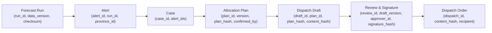

# DengueSense — Báo Cáo Sẵn Sàng Trình Diễn Cuộc Thi (Competition Readiness Report)

> **Tài liệu kiểm kê hiện trạng kỹ thuật, tính toàn vẹn dữ liệu và lộ trình loại bỏ mock phục vụ trình diễn cuộc thi.**

---

## 1. Các Màn Hình & Luồng Nghiệp Vụ Cần Thiết

| STT | Màn hình / Route | Mục đích trình diễn | Persona sử dụng | Service backend chịu trách nhiệm |
|---|---|---|---|---|
| 1 | `/app/ban-do` | Bản đồ rủi ro dịch tễ 34 tỉnh, khoảng tin cậy Conformal (80%, 90%, 95%), giải thích SHAP | `viewer`, `analyst` | `gateway`, `forecast`, `surveillance` |
| 2 | `/app/luot-du-bao` | Quản lý lượt chạy dự báo (backtest / online), theo dõi tiến độ job nền | `analyst` | `gateway`, `forecast` |
| 3 | `/app/canh-bao` | Danh sách cảnh báo dịch theo ngưỡng Breteau ($BI \ge 30$) và số ca vượt ngưỡng | `officer` | `gateway`, `workflow` |
| 4 | `/app/ho-so` & `/app/ho-so/$caseId` | Quản lý hồ sơ dịch, lập & khóa phương án phân bổ vật tư (ULV, hóa chất, giường) | `officer` | `gateway`, `workflow` |
| 5 | `/app/du-thao/$draftId` | Xem dự thảo B2G/B2B, đối soát 6 guardrails, trích dẫn pháp lý nguyên văn, duyệt 4 mắt & ký số | `officer`, `approver` | `gateway`, `workflow`, `genai` |
| 6 | `/app/mo-hinh` | Minh bạch mô hình (Model Card), 12 điểm yếu/giới hạn, bảng đánh giá kinh tế y tế (ICER) | `viewer`, `analyst` | `gateway`, `forecast` |

---

## 2. Nguồn Dữ Liệu & Service Phụ Trách Từng Luồng

| Luồng | Nguồn dữ liệu gốc | Định dạng lưu trữ | Service phụ trách | Trạng thái thực tế |
|---|---|---|---|---|
| **Dịch tễ lịch sử (SXH)** | Bộ Y tế / Viện Pasteur (1997 - 2010) cho 34 tỉnh/thành | CSV / Parquet trong `ai-service/data` | `surveillance`, `forecast` | Dữ liệu lịch sử thật đã chuẩn hóa địa giới hành chính |
| **Khí hậu ERA5-Land** | ECMWF ERA5-Land Reanalysis (Nhiệt độ, Lượng mưa, Độ ẩm) | GeoTIFF / NetCDF zonal stats | `ai-service` feature pipeline | Dữ liệu tái phân tích khí hậu thật từ vệ tinh/mô hình |
| **Cảnh báo (Alerts)** | Sinh tự động khi $BI \ge 30$ hoặc ca vượt $P_{75}$ từ forecast run | Table `workflow.alerts` (PostgreSQL) | `workflow` | Service Go ghi nhận vào PostgreSQL |
| **Hồ sơ & Phân bổ (Plans)** | Đầu vào từ cán bộ + tham số tối ưu vật tư | Table `workflow.cases`, `workflow.allocation_plans` | `workflow`, `optimize` | Hỗ trợ lưu trữ snapshot bất biến kèm hash SHA-256 |
| **Dự thảo GenAI (Drafts)** | Gemini 2.5 Flash + Guardrail Engine G1-G6 | Table `workflow.dispatch_drafts` (PostgreSQL) | `genai` (FastAPI), `workflow` (Go) | Gemini thật có kiểm tra fallback; đối soát trích dẫn tĩnh |
| **Phê duyệt (Reviews)** | Chữ ký số mô phỏng của Approver (SHA-256 hash snapshot) | Table `workflow.reviews`, `workflow.dispatches` | `workflow` | Ghi log bất biến, thực thi quy tắc 4 mắt |

---

## 3. Danh Sách Mock / Fallback trong Runtime & Kế Hoạch Thay Thế

| Vị trí | Hiện trạng runtime | Kế hoạch loại bỏ / Thay thế thật |
|---|---|---|
| **Frontend MSW (`src/mocks`)** | Worker `mockServiceWorker.js` can thiệp chặn API khi chạy ở chế độ demo | Chuyển chế độ sang gọi API Gateway qua HTTPS thật. Tách biệt hoàn toàn code MSW chỉ dùng cho Vitest unit tests. |
| **Routing `/app/ho-so/$caseId`** | TanStack Router bị chặn do file `ho-so.tsx` đóng vai trò layout route nhưng thiếu `<Outlet />` | Tách route danh sách thành `ho-so/index.tsx` và chi tiết thành `ho-so/$caseId.tsx` (hoặc chèn `<Outlet />`), bảo đảm deep link & reload hoạt động độc lập. |
| **Hiển thị tháng mục tiêu** | Thẻ hiển thị "Tháng 06/2010 (+3T)" gây hiểu nhầm tháng mục tiêu là 06/2010 | Dùng `addMonths(origin_month, horizon)` để hiển thị rõ ràng "Tháng 09/2010 (Neo 06/2010 +3T)". |
| **Nguồn trích dẫn Nghị định 30** | URL `docid=199514` trỏ nhầm sang văn bản khác | Cập nhật URL chính thức trên Cổng TTĐT Chính phủ: `https://vanban.chinhphu.vn/default.aspx?docid=199378&pageid=27160`. |
| **Bộ giải phân bổ (Optimize)** | Fallback tính toán nội suy tĩnh khi bộ giải MILP không phản hồi | Khi gọi optimizer thất bại, trả lỗi tường minh; ghi rõ nguồn thuật toán tối ưu là solver thật hay thông số can thiệp do cán bộ nhập. |

---

## 4. Dữ Liệu, Tài Khoản & Quyền Bên Ngoài Còn Thiếu

1. **Khóa API Gemini mới**:
   - Cần thiết lập biến môi trường `GEMINI_API_KEY` mới trong môi trường backend/Docker Compose (sau khi thu hồi key cũ).
2. **Cấu hình DNS / SSL cho Gateway**:
   - Khi triển khai production/staging công khai ngoài Vercel, cần reverse proxy (Caddy / Nginx) cấp chứng chỉ HTTPS cho Go Gateway.
3. **Dữ liệu dịch tễ sau 2010**:
   - Kho dữ liệu công khai chuẩn hóa của Việt Nam trong repo hiện bao phủ giai đoạn 1997 - 2010 (34 tỉnh thành).
   - Mọi dự báo sau 2010 phải được ghi rõ là **mô phỏng / kịch bản diễn tập**, không được nhận vơ là số ca thực tế thời gian thực.

---

## 5. Phân Biệt Rõ Ràng: Dữ Liệu Thật, Lịch Sử và Giả Định

1. **Dữ liệu thật (Ground Truth Lịch sử)**:
   - Số ca mắc SXH hàng tháng theo 34 tỉnh thành giai đoạn 1997 - 2010 từ niên giám dịch tễ Bộ Y tế.
   - Dữ liệu khí hậu tái phân tích ERA5-Land hàng tháng (nhiệt độ, lượng mưa, độ ẩm).
   - Danh mục 34 tỉnh thành theo bảng mã chuẩn hóa mới.
2. **Dữ liệu mô phỏng / Giả định (Hypothetical & Simulation)**:
   - Các cảnh báo bùng phát dịch theo kịch bản diễn tập.
   - Tham số định mức vật tư can thiệp (lít hóa chất, máy phun ULV, mùng màn, cơ số dịch truyền).
   - Kịch bản can thiệp S1, S2, S3 trong tab so sánh kịch bản.
3. **Dữ liệu dự báo (Forecast Outputs)**:
   - Kết quả dự báo điểm và dải khoảng tin cậy Conformal Prediction (80%, 90%, 95%) từ mô hình LightGBM / CatBoost / SEIR-V.

---

## 6. Những Tuyên Bố Tuyệt Đối Không Đưa Ra (Honesty Boundaries)

-  **Không tuyên bố RAG**: Hệ thống hiện đối soát trích dẫn pháp lý theo **danh mục tĩnh đã kiểm chứng (static verified catalog)** từ Công báo Chính phủ, chưa tích hợp vector database / dynamic retrieval RAG.
-  **Không tuyên bố Real-Time (Thời gian thực)**: Dữ liệu dịch tễ y tế công cộng được thu thập theo chu kỳ tháng/tuần; dự báo theo tầm 1-6 tháng, không phải streaming real-time từng giây.
-  **Không tuyên bố Zero Hallucination**: Hệ thống dùng 6 guardrails tự động để phát hiện và chặn vi phạm; không tuyên bố LLM hoàn hảo 100%.
-  **Không tuyên bố Chữ ký số pháp lý quốc gia (VGCA)**: Hệ thống sử dụng chữ ký điện tử mô phỏng (SHA-256 content hash + danh tính approver) để kiểm tra luồng nghiệp vụ 4 mắt, chưa tích hợp USB Token / HSM của Ban Cơ yếu Chính phủ.

---

## 7. Chuỗi Định Danh Truy Nguyên Nguồn Gốc (Data Provenance Chain)

Mọi văn bản chỉ đạo và phương án phân bổ đều có thể truy ngược nguồn gốc theo chuỗi ID và Checksum sau:

