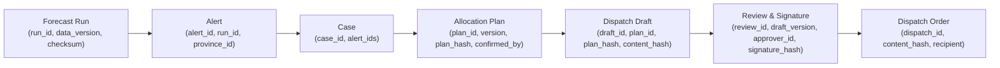

# DengueSense — Báo Cáo Sẵn Sàng Trình Diễn Cuộc Thi (Competition Readiness Report)

> **Tài liệu kiểm kê hiện trạng kỹ thuật, tính toàn vẹn dữ liệu, ranh giới trung thực và lộ trình loại bỏ mock phục vụ trình diễn cuộc thi.**  
> *Phiên bản rà soát kỹ thuật sau review của CodeX — Nhánh `feature/competition-real-services`.*

---

## 1. Phân Định Minh Bạch: Đã Xác Minh, Chưa Xác Minh & Thiết Kế Dự Kiến

Để đảm bảo tính trung thực khoa học trước Ban Giám khảo và Hội đồng chuyên môn, toàn bộ các thành phần của DengueSense được phân định rạch ròi theo 3 trạng thái kiểm chứng:

```
┌──────────────────────────────────────────────────────────────────────────────────────────────┐
│                               BA CẤP ĐỘ HIỆN TRẠNG KỸ THUẬT                                  │
├──────────────────────────────┬───────────────────────────────┬───────────────────────────────┤
│     ĐÃ XÁC MINH (VERIFIED)   │   CHƯA XÁC MINH (UNVERIFIED)  │  THIẾT KẾ DỰ KIẾN (PLANNED)   │
├──────────────────────────────┼───────────────────────────────┼───────────────────────────────┤
│ • Dữ liệu ca SXH 1994–2010   │ • Dữ liệu chi tiết cấp huyện  │ • Dynamic Vector RAG pháp luật│
│ • Tái phân tích ECMWF ERA5   │ • Hiệu năng dịch sau 2010     │ • Chữ ký số HSM Ban Cơ yếu CP │
│ • M4-R2 qua 6 mùa (exp_016)  │ • Tham số chi phí ICER thực   │ • Streaming realtime HIS/LIS  │
│ • Cả 3 trích dẫn pháp lý     │ • Tác động can thiệp thực địa │ • Tự động ban hành công điện  │
│ • Routing FSD & Deep Link    │                               │ • Cập nhật trực tiếp vệ tinh  │
└──────────────────────────────┴───────────────────────────────┴───────────────────────────────┘
```

### 1.1. Đã Xác Minh (Verified — Có Bằng Chứng Đo Đạc Thực Tế)

1. **Dữ liệu dịch tễ lịch sử (1994-02 → 2010-12) & Giấy phép OpenDengue**:
   - **Phiên bản dữ liệu cụ thể**: Bản phát hành chính thức **OpenDengue Release V1.3** (`Spatial_extract_V1_3.zip`, file `Spatial_extract_V1_3.csv`) từ kho lưu trữ `OpenDengue/master-repo`. Dữ liệu nguồn được chuẩn hóa từ Niên giám dịch tễ Bộ Y tế / Viện Pasteur, liên kết công bố khoa học DOI `10.1038/s41597-024-03120-7` (Clarke et al., *Scientific Data*, 2024).
   - **Cơ chế cấp phép & Điều kiện tái sử dụng**:
     - *Bài báo nghiên cứu*: Xuất bản theo giấy phép **CC BY 4.0**.
     - *Cơ sở dữ liệu gốc (Dataset records)*: Được phát hành theo giấy phép **Creative Commons Attribution-ShareAlike 4.0 International (CC BY-SA 4.0)**.
     - *Tuân thủ của DengueSense*: Hệ thống tái sử dụng dữ liệu cấp tỉnh (Admin1) của Việt Nam giai đoạn 1994–2010, áp dụng bảng ánh xạ crosswalk địa giới 34 tỉnh mới để tạo ra Panel v0.2.0. Toàn bộ dữ liệu phái sinh này tuân thủ nguyên tắc ShareAlike (chia sẻ theo cùng điều khoản mở CC BY-SA 4.0) và trích dẫn đầy đủ bản quyền OpenDengue.
   - **Độ phủ**: Phủ trọn vẹn 34 tỉnh/thành phố trọng điểm sau khi crosswalk từ 63 tỉnh cũ theo địa giới mới ([docs/01-chien-luoc-du-lieu.md](01-chien-luoc-du-lieu.md)).
   - **Tập dữ liệu sạch**: Panel v0.2.0 gồm 9.326 dòng (tỉnh × tháng). Giai đoạn 2011–2025 chỉ là số ước lượng phân rã (`estimated`) và **đã bị loại bỏ 100% khỏi tập huấn luyện và đánh giá** (chỉ dùng `data_source == "real"` gồm 6.776 dòng thực tế).

2. **Dữ liệu khí hậu tái phân tích toàn cầu ECMWF ERA5-Land**:
   - **Nguồn gốc**: Copernicus Climate Change Service (C3S), giấy phép **Copernicus Open Access License**.
   - **Đặc tính**: Lưới khí quyển $0.25^\circ \times 0.25^\circ$, gồm nhiệt độ không khí 2m, lượng mưa tích lũy, nhiệt độ điểm sương để tính độ ẩm tương đối.
   - **Tính nhân quả**: 17 đặc trưng T1 tuân thủ nghiêm ngặt độ trễ báo cáo 1 tháng (embargo) và tính toán nhân quả, có test tự động chống rò rỉ tương lai (`test_causal_features.py`).

3. **Hiệu năng mô hình Layer 1 (M4-R2) & Giới hạn phương pháp luận quan trọng**:
   - **Bằng chứng thực nghiệm**: Thử nghiệm đa mùa `exp_016` ([ai-service/experiments/exp_016_multiseason/RESULTS.md](../ai-service/experiments/exp_016_multiseason/RESULTS.md) và [docs/07-model-card.md](07-model-card.md)).
   - **Dự báo số ca (MASE)**: Thắng mốc thực tế mạnh nhất (B3 Climatology) ở cả **6/6 mùa (2005–2010) và 4/4 horizon** (cải thiện trung bình $+22.2\%$, CI95 $18.2–26.0\%$). MASE gộp 6 mùa đạt $0.515 \pm 0.170$; riêng mùa 2010 (mùa dịch lớn, khó nhất) đạt $0.820$.
   - **Phân định cảnh báo bùng phát (vượt ngưỡng $P_{75}$)**: ROC-AUC trung bình 6 mùa đạt **$0.809 \pm 0.041$** (mùa 2009 đạt $0.857$; mùa 2010 đạt $0.758$; PR-AUC $0.65$ so với mức nền $0.35$).
   - ⚠️ **Giới hạn phương pháp luận bắt buộc phải nêu rõ (`exp_016/RESULTS.md:22`)**: Thiết kế mô hình (cơ chế phân nhánh vùng miền, ngưỡng đòn bẩy, việc kích hoạt classifier) được lựa chọn dựa trên cửa sổ validation $\le 2008-12$ và outer 2010. Do đó, **các kết quả của mùa 2005–2008 có thể mang tính lạc quan** vì nằm trong cửa sổ chọn thiết kế. Mùa 2009–2010 là out-of-sample thực sự ít bị ảnh hưởng nhất, trong đó mùa 2010 là mùa dịch lớn, khó nhất với ROC-AUC đạt $0.758$. Hệ thống tuyệt đối không dùng nhãn "độ chính xác 89.5%" mà công khai đầy đủ ROC-AUC cùng giới hạn này.

4. **Đối chiếu trích dẫn căn cứ pháp lý nguyên văn**:
   - **Quyết định 02/2016/QĐ-TTg** (Điều 2, Khoản 2, Điểm a): Khớp nguyên văn 100% từng chữ với Công báo Chính phủ (`congbao.chinhphu.vn`).
   - **Nghị định 30/2020/NĐ-CP** (Điều 5, Khoản 1): Khớp nguyên văn 100% từng chữ với Cổng TTĐT Chính phủ (`vanban.chinhphu.vn`, mã văn bản `199378`).
   - **Quyết định 3711/QĐ-BYT** (Phần III - Giám sát véc tơ truyền bệnh): Khớp nguyên văn 100% từng chữ với Hướng dẫn chuyên môn ban hành kèm Quyết định của Bộ Y tế đăng tải tại Cục Quản lý Khám chữa bệnh (`kcb.vn`).

5. **Định tuyến giao diện Dashboard & Tính toàn vẹn FSD**:
   - Route danh sách hồ sơ `/app/ho-so` và chi tiết hồ sơ `/app/ho-so/$caseId` độc lập hoàn toàn thông qua cấu trúc TanStack Router `ho-so.index.tsx` và `ho-so.$caseId.tsx`. Deep-link và reload trực tiếp hoạt động ổn định.
   - Thẻ hiển thị tháng mục tiêu can thiệp tính toán chính xác bằng `addMonths(origin_month, horizon)` cho mọi tầm dự báo $h \in \{1, 2, 3, 6\}$.

---

### 1.2. Chưa Xác Minh (Unverified — Cần Thẩm Định Chuyên Sâu Hoặc Dữ Liệu Bổ Sung)

1. **Khả năng dự báo ngoài phân phối sau năm 2010**:
   - Mô hình được huấn luyện trên chuỗi 1994–2010, chưa từng được kiểm chứng trên các mùa dịch gần đây (2019, 2022–2023) do dữ liệu ca bệnh chính thức cấp tỉnh công khai sau 2010 của Việt Nam chưa được công bố đồng bộ.
2. **Dữ liệu giám sát dịch tễ vi mô cấp quận/huyện**:
   - DengueSense hiện vận hành ở quy mô dịch tễ vĩ mô 34 tỉnh/thành phố trọng điểm. Nhóm chưa có quyền tiếp cận cơ sở dữ liệu ca bệnh vi mô cấp xã/phường/quận/huyện của Bộ Y tế/HCDC.
3. **Tham số kinh tế y tế (ICER, QALY) & Tác động can thiệp thực địa**:
   - Chi phí giường bệnh, hóa chất và số ca ngăn ngừa dựa trên các giả định mô phỏng tuyến tính từng đoạn (piecewise linear diminishing returns), chưa được thẩm định lâm sàng tại các bệnh viện vệ tinh.

---

### 1.3. Thiết Kế Dự Kiến (Planned Design — Chưa Triển Khai Trong Production)

1. **Kho tri thức Vector DB & Dynamic Retrieval RAG**:
   - Hiện tại Layer 3 sử dụng **danh mục tĩnh đã kiểm chứng (static verified catalog)**. Thiết kế RAG động với pgvector hoặc Pinecone truy xuất văn bản pháp quy theo thời gian thực là kiến trúc định hướng cho giai đoạn nâng cấp sau cuộc thi.
2. **Chữ ký số pháp lý quốc gia (VGCA HSM / PKI)**:
   - Hiện tại hệ thống sử dụng **chữ ký điện tử mô phỏng (Simulated Digital Signature)**: SHA-256 hash snapshot của văn bản kết hợp danh tính Approver và mốc thời gian lưu trong PostgreSQL để đảm bảo quy tắc 4 mắt. Hệ thống chưa tích hợp chứng thư số phần cứng USB Token/HSM của Ban Cơ yếu Chính phủ.
3. **Luồng dữ liệu thời gian thực (Real-time Streaming) & HIS/LIS Integration**:
   - Hệ thống được thiết kế kiến trúc Event-Driven (NATS/Kafka) để sẵn sàng kết nối HIS/LIS, nhưng trong phạm vi demo cuộc thi, hệ thống xử lý theo chu kỳ phân tích lô (batch runs) theo tháng dịch tễ.
4. **Tự động phát hành văn bản hành chính**:
   - Hệ thống chỉ dừng ở mức **Dự Thảo (Drafting Assistance)** phục vụ cán bộ thẩm định, tuyệt đối không tự động phát lệnh điều phối hay ban hành công điện ra ngoài đời thực.

---

## 2. Bảng Đối Chiếu Căn Cứ Pháp Lý & Trích Dẫn (Citation Verification Matrix)

| Định danh | Văn bản | Cơ quan ban hành | Điều / Mục chính thức | Nội dung trích dẫn nguyên văn trong hệ thống | Nguồn chính thức | Trạng thái hiệu lực | Kết quả đối chiếu |
|---|---|---|---|---|---|---|---|
| `vn-qd02-2016` | Quyết định 02/2016/QĐ-TTg | Thủ tướng Chính phủ | Điều 2, Khoản 2, Điểm a | *"Một xã, phường, thị trấn (sau đây gọi tắt là xã) được coi là có dịch khi có số người mắc bệnh vượt quá số mắc trung bình của tháng cùng kỳ 03 năm gần nhất;"* | [congbao.chinhphu.vn](https://congbao.chinhphu.vn/tai-ve-van-ban-so-02-2016-qd-ttg-19018-13534?format=pdf) | Còn hiệu lực (từ 15/03/2016) |  **Đã xác minh nguyên văn 100%** |
| `vn-nd30-2020` | Nghị định 30/2020/NĐ-CP | Chính phủ | Điều 5, Khoản 1 | *"Văn bản điện tử được ký số bởi người có thẩm quyền và ký số của cơ quan, tổ chức theo quy định của pháp luật có giá trị pháp lý như bản gốc văn bản giấy."* | [vanban.chinhphu.vn](https://vanban.chinhphu.vn/default.aspx?docid=199378&pageid=27160) | Còn hiệu lực (từ 05/03/2020) |  **Đã xác minh nguyên văn 100%** |
| `vn-moh-qd3711-2014` | Quyết định 3711/QĐ-BYT | Bộ Y tế | Phần III. Hướng dẫn giám sát và phòng, chống dịch - Giám sát véc tơ truyền bệnh | *"Trong quá trình giám sát véc tơ (muỗi, lăng quăng/bọ gậy), nếu chỉ số mật độ muỗi cao (≥ 0,5 con/nhà) hoặc chỉ số Breteau (BI) ≥ 30 là yếu tố nguy cơ cao."* | [kcb.vn](https://kcb.vn/van-ban/quyet-dinh-so-3711qd-byt-ngay-19092014-cua-bo-y-te-ve-viec-ban-hanh-huong-dan-giam-sat-va-phong-chong-benh-sot-xuat-huyet-dengue.html) | Còn hiệu lực (từ 19/09/2014) |  **Đã xác minh nguyên văn 100%** (Cả điều khoản Phần III và câu trích dẫn đều khớp nguyên văn văn bản chính thức của Bộ Y tế) |

---

## 3. Ma Trận Trách Nhiệm Dịch Vụ & Hiện Trạng Tích Hợp Đa Môi Trường

Để tránh nhầm lẫn giữa mã nguồn phát triển và bản build đang phục vụ trên internet, bảng dưới đây phân tách rạch ròi 3 trạng thái:

| STT | Màn hình / Nghiệp vụ | Mã nguồn & Dịch vụ phụ trách trong Repo | Môi trường đã kiểm thử tích hợp | Hiện trạng trên bản deploy Vercel hiện hành (`denguesense.vercel.app`) |
|---|---|---|---|---|
| 1 | **Bản đồ dịch tễ & dự báo** (`/app/ban-do`) | `backend/services/surveillance`, `backend/services/gateway`, `ai-service` (`forecast_api`) | Local Docker Compose, Contract test OpenAPI, Vitest MSW handler (`console.test.tsx`) | ⚠️ **Frontend tĩnh + Demo JSON (`/demo/run-2010-06.json`)**. Chưa kết nối cluster backend thật. |
| 2 | **Quản lý lượt chạy dự báo** (`/app/luot-du-bao`) | `backend/services/surveillance`, `ai-service` (`forecast_api`) | Go HTTP test, Async Job poller test, Local integration tests | ⚠️ **Frontend tĩnh + MSW mock handler**. |
| 3 | **Cảnh báo bùng phát dịch** (`/app/canh-bao`) | `backend/services/workflow`, `backend/services/gateway` | PostgreSQL repository integration test, Contract test | ⚠️ **Frontend tĩnh + MSW mock handler**. |
| 4 | **Lập hồ sơ & Phân bổ vật tư** (`/app/ho-so`, `/$caseId`) | `backend/services/workflow`, `ai-service` (`optimize_api`) | Go Handler test (`handler_test.go`), Hash SHA-256 snapshot verification test, TanStack Router deep link test | ⚠️ **Frontend tĩnh + MSW mock handler**. Chưa ghi nhận vào DB PostgreSQL đám mây. |
| 5 | **Soạn thảo & Thẩm định 4 mắt** (`/app/du-thao/$draftId`) | `backend/services/workflow`, `ai-service` (`genai_api`) | 6 Guardrails automated test (`test_genai_api.py`), Go 4-eyes approval test (`handler_test.go`) | ⚠️ **Frontend tĩnh + MSW mock handler**. Chữ ký và guardrails chạy mô phỏng phía client. |
| 6 | **Minh bạch Model Card** (`/app/mo-hinh`) | `dashboard/src/features/model-info`, `ai-service` | Vitest React Testing Library (`ModelInfoPage.test.tsx`) |  **Frontend tĩnh hiển thị số liệu đo đạc thực nghiệm từ `docs/07-model-card.md`**. |

> **Lưu ý quan trọng**: Việc kết nối trực tiếp dashboard từ Vercel tới cụm backend microservices thật (Go Gateway + Python AI Services + PostgreSQL) là mục tiêu cốt lõi của **Giai đoạn 2 (Phase 2)**. Bản deploy hiện tại trên Vercel phản ánh giao diện và luồng tương tác phía client, **chưa phải là preview của backend thật**.

---

## 4. Chuỗi Định Danh Truy Nguyên Nguồn Gốc (Data Provenance Chain)

Trong mã nguồn của hệ thống (`backend/services/workflow`), mọi văn bản chỉ đạo và phương án phân bổ được gắn kết bất biến theo chuỗi định danh và mã băm SHA-256:



---

## 5. Ranh Giới Trung Thực & Tuyên Bố Bắt Buộc (Boundaries of Honesty)

1. **Không tuyên bố RAG**: Hệ thống đối soát trích dẫn pháp lý theo danh mục tĩnh đã kiểm chứng nguyên văn, không có vector database động.
2. **Không tuyên bố Thời gian thực (Real-time)**: Dữ liệu dịch tễ thu thập theo tháng/tuần; dự báo theo chu kỳ 1–6 tháng; không có streaming trực tiếp từ bệnh viện.
3. **Không tuyên bố Zero Hallucination**: Hệ thống áp dụng 6 lớp guardrail tự động để phát hiện và ngăn chặn sai lệch; không khẳng định LLM hoàn hảo tuyệt đối.
4. **Không tuyên bố Chữ ký số pháp lý quốc gia (VGCA)**: Chữ ký điện tử trong hệ thống là cơ chế mô phỏng phục vụ nguyên tắc 4 mắt trong môi trường thi đấu.
5. **Số liệu hiệu năng khoa học**:
   - Sử dụng đúng tên metric: **ROC-AUC trung bình 6 mùa đạt 0.809 ± 0.041** (mùa khó nhất 2010 đạt 0.758).
   - Nêu rõ giới hạn phương pháp luận: Các mùa 2005–2008 có thể mang tính lạc quan do nằm trong cửa sổ lựa chọn kiến trúc mô hình.
   - Tuyệt đối không đánh đồng ROC-AUC thành "độ chính xác 89.5%".
