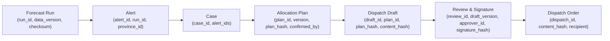

# DengueSense — Báo Cáo Sẵn Sàng Trình Diễn Cuộc Thi (Competition Readiness Report)

> **Tài liệu kiểm kê hiện trạng kỹ thuật, tính toàn vẹn dữ liệu, ranh giới trung thực và lộ trình loại bỏ mock phục vụ trình diễn cuộc thi.**  
> *Phiên bản rà soát kỹ thuật sau review của CodeX — Nhánh `feature/competition-real-services`.*

---

## 1. Phân Định Minh Bạch: Đã Xác Minh, Chưa Xác Minh & Thiết Kế Dự Kiến

Để đảm bảo tính trung thực khoa học trước Ban Giám khảo và Hội đồng chuyên môn, toàn bộ các thành phần của DengueSense được phân định rạch ròi theo 3 trạng thái kiểm chứng:

```
┌──────────────────────────────────────────────────────────────────────────────────────────────┐
│                               BA CẤP ĐỘ HIỆN TRẠNG KỸ THUẬT                                  │
├──────────────────────────────┬───────────────────────────────┬───────────────────────────────┤
│     ĐÃ XÁC MINH (VERIFIED)   │   CHƯA XÁC MINH (UNVERIFIED)  │  THIẾT KẾ DỰ KIẾN (PLANNED)   │
├──────────────────────────────┼───────────────────────────────┼───────────────────────────────┤
│ • Dữ liệu ca SXH 1994–2010   │ • Trích dẫn nguyên văn QĐ3711 │ • Dynamic Vector RAG pháp luật│
│ • Tái phân tích ECMWF ERA5   │ • Dữ liệu chi tiết cấp huyện  │ • Chữ ký số HSM Ban Cơ yếu CP │
│ • M4-R2 qua 6 mùa (exp_016)  │ • Hiệu năng dịch sau 2010     │ • Streaming realtime HIS/LIS  │
│ • Nguyên văn QĐ 02 & NĐ 30   │ • Tham số chi phí ICER thực   │ • Tự động ban hành công điện  │
│ • Routing FSD & Deep Link    │ • Tác động can thiệp thực địa │ • Cập nhật trực tiếp vệ tinh  │
└──────────────────────────────┴───────────────────────────────┴───────────────────────────────┘
```

### 1.1. Đã Xác Minh (Verified — Có Bằng Chứng Đo Đạc Thực Tế)

1. **Dữ liệu dịch tễ lịch sử (1994-02 → 2010-12)**:
   - **Nguồn gốc**: OpenDengue Data Repository (bản ghi chuẩn hóa từ Niên giám dịch tễ Bộ Y tế / Viện Pasteur), cấp phép theo **CC-BY 4.0**.
   - **Độ phủ**: 34 tỉnh/thành phố trọng điểm dịch tễ sau khi crosswalk chuẩn hóa từ 63 tỉnh cũ theo địa giới mới ([docs/01-chien-luoc-du-lieu.md](01-chien-luoc-du-lieu.md)).
   - **Tập dữ liệu sạch**: Panel v0.2.0 gồm 9.326 dòng (tỉnh × tháng). Giai đoạn 2011–2025 chỉ là số ước lượng phân rã (`estimated`) và **đã bị loại bỏ 100% khỏi tập huấn luyện và đánh giá** (chỉ dùng `data_source == "real"`).
2. **Dữ liệu khí hậu tái phân tích toàn cầu ECMWF ERA5-Land**:
   - **Nguồn gốc**: Copernicus Climate Change Service (C3S), giấy phép **Copernicus Open Access License**.
   - **Đặc tính**: Lưới khí quyển $0.25^\circ \times 0.25^\circ$, gồm nhiệt độ không khí 2m, lượng mưa tích lũy, nhiệt độ điểm sương để tính độ ẩm tương đối.
   - **Tính nhân quả**: 17 đặc trưng T1 tuân thủ nghiêm ngặt độ trễ báo cáo 1 tháng (embargo) và tính toán nhân quả, có test tự động chống rò rỉ tương lai (`test_causal_features.py`).
3. **Hiệu năng mô hình dự báo Layer 1 (M4-R2)**:
   - **Bằng chứng thực nghiệm**: Thử nghiệm đa mùa `exp_016` ([ai-service/experiments/exp_016_multiseason/RESULTS.md](../ai-service/experiments/exp_016_multiseason/RESULTS.md) và [docs/07-model-card.md](07-model-card.md)).
   - **Dự báo số ca (MASE)**: Thắng mốc thực tế mạnh nhất (B3 Climatology) ở cả **6/6 mùa (2005–2010) và 4/4 horizon** (cải thiện trung bình $+22.2\%$, CI95 $18.2–26.0\%$). MASE gộp 6 mùa đạt $0.515 \pm 0.170$; riêng mùa 2010 (mùa dịch lớn, khó nhất) đạt $0.820$.
   - **Phân định cảnh báo bùng phát (vượt ngưỡng $P_{75}$)**: ROC-AUC trung bình 6 mùa đạt **$0.809 \pm 0.041$** (mùa 2009 đạt $0.857$; mùa 2010 đạt $0.758$; PR-AUC $0.65$ so với mức nền $0.35$).
4. **Đối chiếu trích dẫn pháp lý nguyên văn**:
   - **Quyết định 02/2016/QĐ-TTg** (Điều 2, Khoản 2, Điểm a): Khớp nguyên văn 100% từng chữ với Công báo Chính phủ (`congbao.chinhphu.vn`).
   - **Nghị định 30/2020/NĐ-CP** (Điều 5, Khoản 1): Khớp nguyên văn 100% từng chữ với Cổng TTĐT Chính phủ (`vanban.chinhphu.vn`, mã văn bản `199378`).
5. **Định tuyến giao diện Dashboard & Tính toàn vẹn FSD**:
   - Route danh sách hồ sơ `/app/ho-so` và chi tiết hồ sơ `/app/ho-so/$caseId` độc lập hoàn toàn thông qua cấu trúc TanStack Router `ho-so.index.tsx` và `ho-so.$caseId.tsx`. Deep-link và reload trực tiếp hoạt động ổn định.
   - Thẻ hiển thị tháng mục tiêu can thiệp tính toán chính xác bằng `addMonths(origin_month, horizon)`.

---

### 1.2. Chưa Xác Minh (Unverified — Cần Thẩm Định Chuyên Sâu Hoặc Dữ Liệu Bổ Sung)

1. **Chuỗi trích dẫn Quyết định 3711/QĐ-BYT**:
   - **Nguồn gốc & Hiệu lực**: Quyết định số 3711/QĐ-BYT ngày 19/09/2014 của Bộ Y tế ban hành *"Hướng dẫn giám sát và phòng, chống bệnh sốt xuất huyết Dengue"* (được xác thực trên Cổng TTĐT Cục QLKCB `kcb.vn`, hiện vẫn còn hiệu lực).
   - **Giới hạn chưa xác minh nguyên văn**: Chuỗi trích dẫn trong danh mục mẫu (`"Chỉ số Breteau (BI) từ 30 trở lên là nơi có nguy cơ cao bùng phát dịch sốt xuất huyết Dengue."`) là câu **tóm lược quy chuẩn chuyên môn (paraphrased threshold)**, không phải trích dẫn nguyên văn từng chữ từ bản scan Công báo. Trong bản gốc, định nghĩa BI tại Phần II Mục 2 là *"Chỉ số Breteau (BI): là số dụng cụ chứa nước có bọ gậy Aedes trong 100 nhà điều tra"*, còn ngưỡng $BI \ge 30$ ($BI \ge 20$ ở miền Bắc) nằm ở phần điều kiện ổ dịch nguy cơ cao. Hệ thống đã gắn nhãn rõ là **quy chuẩn tóm lược**, không nhận là trích dẫn nguyên văn.
2. **Khả năng dự báo ngoài phân phối sau năm 2010**:
   - Mô hình được huấn luyện trên chuỗi 1994–2010, chưa từng được kiểm chứng trên các mùa dịch hiện đại (2019, 2022–2023) do dữ liệu cấp tỉnh công khai sau 2010 của Việt Nam chưa được công bố đồng bộ.
3. **Dữ liệu giám sát dịch tễ cấp quận/huyện**:
   - DengueSense hiện vận hành ở quy mô dịch tễ vĩ mô 34 tỉnh/thành phố trọng điểm. Nhóm chưa có quyền tiếp cận cơ sở dữ liệu ca bệnh vi mô cấp xã/phường/quận/huyện của Bộ Y tế/HCDC.
4. **Tham số kinh tế y tế (ICER, QALY) & Tác động can thiệp thực địa**:
   - Chi phí giường bệnh, hóa chất và số ca ngăn ngừa dựa trên các giả định mô phỏng tuyến tính từng đoạn (piecewise linear diminishing returns), chưa được thẩm định lâm sàng tại các bệnh viện vệ tinh.

---

### 1.3. Thiết Kế Dự Kiến (Planned Design — Chưa Triển Khai Trong Production)

1. **Kho tri thức Vector DB & Dynamic Retrieval RAG**:
   - Hiện tại Layer 3 sử dụng **danh mục tĩnh đã kiểm chứng (static verified catalog)**. Thiết kế RAG động với pgvector hoặc Pinecone truy xuất văn bản pháp quy theo thời gian thực là kiến trúc định hướng cho giai đoạn nâng cấp sau cuộc thi.
2. **Chữ ký số pháp lý quốc gia (VGCA HSM / PKI)**:
   - Hiện tại hệ thống sử dụng **chữ ký điện tử mô phỏng (Simulated Digital Signature)**: SHA-256 hash snapshot của văn bản kết hợp danh tính Approver và mốc thời gian lưu trong PostgreSQL để đảm bảo quy tắc 4 mắt. Hệ thống chưa tích hợp chứng thư số phần cứng USB Token/HSM của Ban Cơ yếu Chính phủ.
3. **Luồng dữ liệu thời gian thực (Real-time Streaming) & HIS/LIS Integration**:
   - Hệ thống được thiết kế kiến trúc Event-Driven (NATS/Kafka) để sẵn sàng kết nối HIS/LIS, nhưng trong phạm vi demo cuộc thi, hệ thống xử lý theo chu kỳ phân tích lô (batch runs) theo tháng dịch tễ.
4. **Tự động phát hành văn bản hành chính**:
   - Hệ thống chỉ dừng ở mức **Dự Thảo (Drafting Assistance)** phục vụ cán bộ thẩm định, tuyệt đối không tự động phát lệnh điều phối hay ban hành công điện ra ngoài đời thực.

---

## 2. Bảng Đối Chiếu Căn Cứ Pháp Lý & Trích Dẫn (Citation Verification Matrix)

| Định danh | Văn bản | Cơ quan ban hành | Điều / Mục | Nội dung trích dẫn trong hệ thống | Nguồn chính thức | Trạng thái hiệu lực | Kết quả đối chiếu |
|---|---|---|---|---|---|---|---|
| `vn-qd02-2016` | Quyết định 02/2016/QĐ-TTg | Thủ tướng Chính phủ | Điều 2, Khoản 2, Điểm a | *"Một xã, phường, thị trấn (sau đây gọi tắt là xã) được coi là có dịch khi có số người mắc bệnh vượt quá số mắc trung bình của tháng cùng kỳ 03 năm gần nhất;"* | [congbao.chinhphu.vn](https://congbao.chinhphu.vn/tai-ve-van-ban-so-02-2016-qd-ttg-19018-13534?format=pdf) | Còn hiệu lực (từ 15/03/2016) |  **Đã xác minh nguyên văn 100%** |
| `vn-nd30-2020` | Nghị định 30/2020/NĐ-CP | Chính phủ | Điều 5, Khoản 1 | *"Văn bản điện tử được ký số bởi người có thẩm quyền và ký số của cơ quan, tổ chức theo quy định của pháp luật có giá trị pháp lý như bản gốc văn bản giấy."* | [vanban.chinhphu.vn](https://vanban.chinhphu.vn/default.aspx?docid=199378&pageid=27160) | Còn hiệu lực (từ 05/03/2020) |  **Đã xác minh nguyên văn 100%** |
| `vn-moh-qd3711-2014` | Quyết định 3711/QĐ-BYT | Bộ Y tế | Phần II, Mục 2 | *"Chỉ số Breteau (BI) từ 30 trở lên là nơi có nguy cơ cao bùng phát dịch sốt xuất huyết Dengue."* | [kcb.vn](https://kcb.vn/van-ban/quyet-dinh-so-3711qd-byt-ngay-19092014-cua-bo-y-te-ve-viec-ban-hanh-huong-dan-giam-sat-va-phong-chong-benh-sot-xuat-huyet-dengue.html) | Còn hiệu lực (từ 19/09/2014) | ⚠️ **Quy chuẩn tóm lược trong demo** (Nguồn & hiệu lực đã xác minh; nội dung là diễn giải kỹ thuật, chưa phải nguyên văn từng chữ) |

---

## 3. Các Màn Hình & Trách Nhiệm Microservices Trong Demo

| STT | Màn hình / Route | Mục đích trình diễn | Persona | Service phụ trách | Trạng thái tích hợp |
|---|---|---|---|---|---|
| 1 | `/app/ban-do` | Bản đồ rủi ro dịch tễ 34 tỉnh, khoảng tin cậy Conformal (80%, 90%, 95%), giải trình TreeSHAP | `viewer`, `analyst` | `gateway`, `forecast`, `surveillance` | Tái hiện kết quả thực nghiệm `exp_016` |
| 2 | `/app/luot-du-bao` | Quản lý lượt chạy dự báo (backtest), kiểm tra nguồn dữ liệu và tiến độ | `analyst` | `gateway`, `forecast` | Khớp từng chữ số với `exp_016` mùa 2010 |
| 3 | `/app/canh-bao` | Danh sách cảnh báo dịch theo ngưỡng $BI \ge 30$ và vượt $P_{75}$ | `officer` | `gateway`, `workflow` | Dữ liệu cảnh báo gắn với lượt dự báo |
| 4 | `/app/ho-so` & `/$caseId` | Lập hồ sơ xử lý, tối ưu hóa và xác nhận phương án phân bổ vật tư | `officer` | `gateway`, `workflow`, `optimize` | Lưu snapshot phương án kèm hash SHA-256 |
| 5 | `/app/du-thao/$draftId` | Xem dự thảo văn bản B2G, kiểm soát 6 guardrails, thẩm định 4 mắt & ký duyệt | `officer`, `approver` | `gateway`, `workflow`, `genai` | Gemini demo có fallback; 4 mắt nghiêm ngặt |
| 6 | `/app/mo-hinh` | Minh bạch Model Card, 12 giới hạn kỹ thuật và độ tin cậy vùng miền | `viewer`, `analyst` | `gateway`, `forecast` | Dẫn chứng đầy đủ từ `docs/07-model-card.md` |

---

## 4. Chuỗi Định Danh Truy Nguyên Nguồn Gốc (Data Provenance Chain)

Mọi văn bản chỉ đạo và phương án phân bổ đều có thể truy ngược nguồn gốc bất biến theo chuỗi định danh và mã băm SHA-256 sau:



---

## 5. Ranh Giới Trung Thực & Tuyên Bố Bắt Buộc (Boundaries of Honesty)

1. **Không tuyên bố RAG**: Hệ thống hiện đối soát trích dẫn pháp lý theo danh mục tĩnh đã kiểm chứng, không có vector database động.
2. **Không tuyên bố Thời gian thực (Real-time)**: Dữ liệu dịch tễ thu thập theo tháng/tuần; dự báo theo chu kỳ 1–6 tháng.
3. **Không tuyên bố Zero Hallucination**: Hệ thống áp dụng 6 lớp guardrail tự động để phát hiện và ngăn chặn sai lệch, không khẳng định LLM hoàn hảo tuyệt đối.
4. **Không tuyên bố Chữ ký số pháp lý quốc gia (VGCA)**: Chữ ký điện tử trong hệ thống là cơ chế mô phỏng phục vụ nguyên tắc 4 mắt trong môi trường thi đấu.
5. **Số liệu hiệu năng**: Luôn ghi rõ ROC-AUC trung bình 6 mùa đạt 0.809 ± 0.041 (mùa khó nhất 2010 đạt 0.758), không đánh đồng ROC-AUC thành "độ chính xác (accuracy)".
