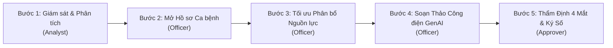

# DengueSense — Hướng Dẫn Kiểm Thử & Kịch Bản Diễn Tập Hệ Thống

> **Tài liệu hướng dẫn nghiệm thu và diễn tập luồng tác chiến khép kín**  
> Dự án: **DengueSense — Nền tảng Giám sát Dịch tễ & Hỗ trợ Ra Quyết định Khép kín Phòng chống Sốt Xuất Huyết**  
> Dành cho: Ban giám khảo, Chuyên gia đánh giá, Cán bộ y tế dự phòng và Đội ngũ phát triển.

---

## 1. Giới Thiệu & Kiến Trúc Tổng Thể

DengueSense là giải pháp chuyển đổi số y tế dự phòng hỗ trợ kiểm soát dịch bệnh Sốt xuất huyết Dengue (SXH) tại **34 tỉnh/thành phố trọng điểm** của Việt Nam. Hệ thống hiện thực hóa chu trình tác chiến khép kín gồm 3 tầng kỹ thuật:

```
┌───────────────────────────────────────────────────────────────────────────────┐
│                           DENGUESENSE ARCHITECTURE                            │
├───────────────────────────────────────────────────────────────────────────────┤
│                                                                               │
│  [ TẦNG 1: DỰ BÁO DỊCH TỄ KHÔNG GIAN - THỜI GIAN ]                            │
│  • Mô hình Hurdle LightGBM (M4-R2) dự báo 1, 2, 3, 6 tháng                    │
│  • Dữ liệu giám sát 1994–2010 (OpenDengue V1.3) + Khí tượng ERA5             │
│  • Hiệu chuẩn bất định Conformal Prediction (khoảng tin cậy 80%, 90%, 95%)    │
│  • Mô hình động học dịch tễ SEIR-V đánh giá can thiệp véc-tơ                  │
│                                      │                                        │
│                                      ▼                                        │
│  [ TẦNG 2: TỐI ƯU HÓA PHÂN BỔ NGUỒN LỰC (Google OR-Tools MILP) ]              │
│  • Thuật toán quy hoạch nguyên hỗn hợp (Mixed-Integer Linear Programming)    │
│  • Cân đối ngân sách, cơ số Cloramin B, hóa chất diệt lăng quăng, giường bệnh  │
│  • Đội phản ứng nhanh & kế hoạch điều phối chi viện kho liên tỉnh             │
│                                      │                                        │
│                                      ▼                                        │
│  [ TẦNG 3: SOẠN THẢO VĂN BẢN GENAI CÓ KIỂM SOÁT (Guardrailed RAG) ]          │
│  • Soạn thảo Công điện khẩn B2G & Kế hoạch can thiệp chuẩn Nghị định 30      │
│  • Truy hồi tri thức pháp quy: QĐ 3711/QĐ-BYT, QĐ 02/2016/QĐ-TTg             │
│  • 6 chốt an toàn Guardrails (G1 - G6): Đối chiếu nguyên văn & cấm bịa đặt    │
│  • Cơ chế phê duyệt độc lập 4 mắt (Four-Eyes Principle) & Ký số hành chính   │
│                                                                               │
└───────────────────────────────────────────────────────────────────────────────┘
```

---

## 2. Thông Tin Truy Cập & Danh Sách Tài Khoản

Hệ thống hỗ trợ 2 môi trường truy cập:

1. **Môi trường Cục bộ Đầy đủ (Full Local Stack - 12 Docker Containers):**
   - **Giao diện Console:** `http://127.0.0.1:3000`
   - **API Gateway Trung tâm:** `http://127.0.0.1:18080`
   - **GenAI RAG Offline Endpoint:** `http://127.0.0.1:8003/internal/v1/genai/rag/query`
2. **Môi trường Trực tuyến (Vercel Preview):**
   - **Website:** `https://denguesense.vercel.app/`

### Bảng Tài Khoản Theo Vai Trò (RBAC)

| Vai trò (Role) | Chức danh & Quyền hạn | Tài khoản Docker Local | Mật khẩu Docker Local | Tài khoản Demo Vercel | Mật khẩu Demo Vercel |
| :--- | :--- | :--- | :--- | :--- | :--- |
| **Analyst** | **Chuyên viên Dịch tễ:** Giám sát bản đồ rủi ro, chạy run dự báo, phân tích đặc trưng SHAP, xuất báo cáo CSV | `dev-analyst` | `ujMOTLmI2sRHa7X-oN7L9oky` | `demo.phan-tich` | `demo-2026-phan-tich` |
| **Officer** | **Cán bộ Điều hành CDC:** Tiếp nhận cảnh báo, mở hồ sơ ca bệnh, tối ưu phân bổ nguồn lực MILP, yêu cầu AI soạn dự thảo | `local-officer` | `eFYfEnkTNu1xtbA3yjcIBbE5T7HpcpOk` | `officer` | `officer123456` |
| **Approver** | **Lãnh đạo Phê duyệt (Cục YTDP / Sở Y tế):** Thẩm định công điện, kiểm tra trích dẫn, ký số điện tử phê duyệt hoặc từ chối có lý do | `local-approver` | `xsMTZjIgExiPXtNFHjws62V39nXF6h7b` | `approver` | `approver123456` |
| **Viewer** | **Người xem / Tra cứu Công khai:** Xem bản đồ dịch tễ, tra cứu thông tin mô hình, xem hồ sơ công khai (chế độ chỉ đọc) | `dev-viewer` | `a6BlIE3BM_whDmzRPxIbMK6O` | `demo.xem` | `demo-2026-xem` |

> [!TIP]
> **Thanh chuyển nhanh 1-Click trong Chế độ Demo:**  
> Khi trải nghiệm trên giao diện (ở chế độ Demo), góc trên màn hình có thanh công cụ **"Chuyển nhanh vai trò"**. Bạn có thể bấm trực tiếp vào tên vai trò (`Người xem`, `Chuyên viên`, `Cán bộ`, `Lãnh đạo`) để chuyển đổi danh tính ngay lập tức mà không cần đăng xuất và gõ lại mật khẩu.

---

## 3. Kịch Bản Diễn Tập Nghiệp Vụ Khép Kín 5 Bước

Kịch bản dưới đây mô phỏng chu trình ứng phó tình huống dịch bùng phát tại khu vực Duyên hải Miền Trung và Tây Nam Bộ trong mùa mưa:



---

### Bước 1: Giám sát, Dự báo Dịch tễ & Phân tích Nguyên nhân (Vai trò: Analyst)

1. **Đăng nhập:** Đăng nhập tài khoản `dev-analyst` (hoặc chuyển sang **Chuyên viên**).
2. **Truy cập Bản đồ Rủi ro (`/app/ban-do`):**
   - Chọn tháng neo: **`03/2010`** (Lượt tái hiện mùa dịch 2010 có đầy đủ dữ liệu thực địa).
   - Chọn tầm dự báo: **`3 tháng`** $\rightarrow$ Hệ thống tự động tính toán tháng mục tiêu: **`Tháng 06/2010`** (điểm rơi đỉnh dịch).
   - Bật chế độ chạy tự động (**Phát chu kỳ 1T → 2T → 3T → 6T**) để quan sát sự lan rộng của vùng nguy cơ cao.
   - Quan sát bảng xếp hạng 34 tỉnh: Cột **Xác suất vượt ngưỡng** luôn đi kèm **Mức nền lịch sử (Base Rate)** để tránh sai lệch nhận thức (nguyên tắc minh bạch dịch tễ).
3. **Phân tích Tỉnh trọng điểm (`/app/tinh/da_nang` hoặc `/app/tinh/an_giang`):**
   - Xem biểu đồ dự báo số ca mắc kèm khoảng tin cậy Conformal Prediction (80%, 90%, 95%).
   - Xem biểu đồ đóng góp đặc trưng SHAP: Phân tích vì sao rủi ro tăng cao (do lượng mưa tích lũy tháng trước tăng đột biến, nhiệt độ trung bình từ 27–31°C thuận lợi cho muỗi truyền bệnh).
4. **Xuất Báo cáo Nghiệp vụ:**
   - Nhấp **"Xuất CSV (Excel)"** tại góc phải bản đồ để tải bảng dữ liệu dự báo toàn quốc.

---

### Bước 2: Sàng lọc Cảnh báo & Khởi tạo Hồ sơ Tác chiến (Vai trò: Officer)

1. **Chuyển vai trò:** Đăng nhập `local-officer` (hoặc bấm **Cán bộ** trên thanh chuyển vai trò).
2. **Truy cập Trung tâm Cảnh báo (`/app/canh-bao`):**
   - Danh sách cảnh báo tự động lọc các địa phương có xác suất $P \ge 0.50$ hoặc vượt ngưỡng dịch P75.
   - Sử dụng bộ lọc khu vực: Chọn **"Miền Nam"** hoặc **"Miền Trung"**.
3. **Mở Hồ sơ Xử lý:**
   - Nhấp vào nút **"Mở hồ sơ xử lý"** tại một cảnh báo mức Cao.
   - Nhập tiêu đề hồ sơ:  
     `Kế hoạch ứng phó khẩn cấp dịch Sốt xuất huyết khu vực miền Nam (Tháng 06/2010)`
   - Nhấp **"Tạo hồ sơ"** $\rightarrow$ Hệ thống điều hướng ngay tới trang chi tiết hồ sơ: `/app/ho-so/$caseId`.

---

### Bước 3: Tối ưu Phân bổ Nguồn lực Can thiệp MILP (Vai trò: Officer)

1. **Tại Trang Chi tiết Hồ sơ (`/app/ho-so/$caseId`):**
   - Quan sát 3 thẻ tổng hợp KPI:
     - **Ngân sách dự kiến:** Ngân sách được phân bổ.
     - **Tổng chi phí tối ưu:** Chi phí tính toán qua mô hình MILP.
     - **Ước tính số ca ngăn chặn:** Số ca dự kiến không bị mắc bệnh nhờ can thiệp sớm ($\approx 1.250$ ca).
2. **Kiểm tra Bảng Phân bổ Nguồn lực:**
   - Bảng phân bổ được ưu tiên hiển thị ngay bên dưới thẻ KPI, thể hiện rõ:
     - Số lượng hóa chất Cloramin B / Permethrin cấp cho từng tỉnh.
     - Cơ số giường cấp cứu SXH bổ sung cho các bệnh viện tuyến đầu.
     - Số đội phản ứng nhanh cơ động hỗ trợ dập ổ dịch.
     - Dự toán kinh phí và cơ sở giải trình dịch tễ.
3. **Xác nhận Phương án Phân bổ:**
   - Nhấp nút **"Xác nhận phương án"** (nút màu xanh). Trạng thái chuyển thành: `Đã xác nhận (v1)`.
   - *Ý nghĩa nghiệp vụ:* Việc xác nhận phương án sẽ khóa số liệu và chuyển thẳng bảng số liệu này sang cấu trúc trích xuất của Layer 3 GenAI.
4. **Khối Phân tích Chuyên sâu (Đã tinh gọn dưới dạng Collapsible):**
   - Bấm mở khối **"Phân tích chuyên sâu: Đánh giá Kinh tế Y tế & Diễn tập Đối sánh (Mô phỏng)"** bên dưới bảng phân bổ.
   - Quan sát các chỉ số CEA/DALY (chi phí trên mỗi năm sống điều chỉnh theo bệnh tật được cứu), tỷ số Chi phí - Lợi ích (B/C Ratio) và bảng đối sánh 3 kịch bản can thiệp.
5. **Điều phối Chi viện Liên tỉnh:**
   - Nhấp nút **"Chi viện liên tỉnh"** $\rightarrow$ Hệ thống mở bảng đề xuất điều động hóa chất và vật tư từ các CDC lân cận ít nguy cơ sang tâm dịch; có hỗ trợ xuất biên bản bàn giao CSV.

---

### Bước 4: Soạn thảo Văn bản Chỉ đạo bằng GenAI có Guardrails (Vai trò: Officer)

1. **Yêu cầu AI Sinh Dự thảo:**
   - Tại Mục 3 trong trang hồ sơ ("Dự thảo văn bản chỉ đạo"), nhấp **"Yêu cầu AI soạn thảo"**.
   - Chọn loại hình văn bản: **Công điện khẩn (B2G)** hoặc **Kế hoạch hành động liên ngành**.
   - Nhấp **"Bắt đầu soạn thảo"**.
2. **Cơ chế Xử lý Ngầm của GenAI RAG:**
   - Hệ thống tự động truy hồi trích dẫn từ kho văn bản quy phạm:
     - **Quyết định 3711/QĐ-BYT:** Định nghĩa ngưỡng dịch tễ (BI $\ge 20$, DI $\ge 0.5$ con/nhà) và phác đồ dập dịch diện rộng.
     - **Quyết định 02/2016/QĐ-TTg:** Quy định điều kiện công bố dịch bệnh truyền nhiễm.
     - **Nghị định 30/2020/NĐ-CP:** Quy chuẩn thể thức công văn hành chính nhà nước.
   - Mô hình nhúng chính xác số liệu ngân sách và vật tư đã được chốt ở Bước 3 vào nội dung điều hành.
3. **Kiểm tra Dự thảo Tại Trang `/app/du-thao/$draftId`:**
   - Cột trái: Văn bản hiển thị chuẩn thể thức (Quốc hiệu, Tiêu ngữ, Số ký hiệu, Nơi nhận, Điều khoản).
   - Cột phải: Bảng kiểm soát **6 Chốt An Toàn (Guardrails Checklist)**:
     - **G1 (Bắt buộc viện dẫn căn cứ pháp lý):** Đạt.
     - **G2 (Khớp số liệu ngân sách & vật tư):** Không bị sai lệch 1 đồng so với bảng phân bổ.
     - **G3 (Đối chiếu nguyên văn trích dẫn QĐ 3711):** Nguồn HTTPS hợp lệ, không trích dẫn sai điều khoản.
     - **G4 (Chuẩn thể thức Nghị định 30/2020):** Đầy đủ bố cục văn bản hành chính.
     - **G5 (Giọng văn mệnh lệnh hành chính):** Đạt chuẩn văn phong công vụ.
     - **G6 (Không tự ý kê đơn / chẩn đoán y khoa cá nhân):** Đạt.

---

### Bước 5: Thẩm Định 4 Mắt & Ký Số Phê Duyệt (Vai trò: Approver)

1. **Chuyển vai trò sang Lãnh đạo:** Đăng nhập `local-approver` (hoặc bấm **Lãnh đạo** trên thanh chuyển vai trò).
2. **Kiểm tra Văn bản & Ký số Phê duyệt:**
   - Đọc nội dung công điện và kết quả đối soát tại `/app/du-thao/$draftId`.
   - Nhấp nút **"Phê duyệt văn bản"** (màu xanh).
   - Hệ thống hiển thị hộp thoại xác nhận ký số với dấu thời gian và mã định danh phê duyệt.
   - Bấm **"Xác nhận phê duyệt"** $\rightarrow$ Văn bản chuyển trạng thái sang **`APPROVED` (Đã phê duyệt)**.
3. **Ban hành & Lưu trữ:**
   - Nhấp **"Xuất Word (.doc)"** để tải tệp công điện chuẩn thể thức Microsoft Word về máy.
   - Nhấp **"In / Xuất PDF"** để mở bản in công vụ sạch (đã ẩn các nút điều khiển giao diện).

---

## 4. Các Ca Kiểm Thử Âm Tính & An Toàn Bảo Mật (Fail-Closed)

Hệ thống được thiết kế theo nguyên tắc an toàn nghiêm ngặt (Fail-Closed). Dưới đây là các ca kiểm thử bảo mật cần kiểm chứng:

| STT | Tình huống kiểm thử | Hành vi kỳ vọng (Hệ thống chặn thành công) | Kết quả thực tế |
| :---: | :--- | :--- | :---: |
| **TC-01** | **Chặn vi phạm Quy tắc 4 mắt:**<br/>Cán bộ soạn thảo (`local-officer`) cố tình tự phê duyệt công điện do chính mình tạo | Nút **"Phê duyệt văn bản"** bị ẩn hoặc vô hiệu hóa hoàn toàn; hiển thị hộp cảnh báo màu vàng: *"Theo quy tắc 4 mắt, người soạn thảo không được phép tự phê duyệt văn bản của chính mình."* | **ĐẠT** |
| **TC-02** | **Chặn trích dẫn nguồn không an toàn:**<br/>Trích dẫn pháp lý chứa URL không có HTTPS (http://...) | Validator chốt an toàn G3 lập tức từ chối và cảnh báo vi phạm an toàn; không cho phép công nhận citation. | **ĐẠT** |
| **TC-03** | **Chặn từ chối văn bản thiếu lý do:**<br/>Lãnh đạo bấm "Từ chối" nhưng để trống ô giải trình lý do | Nút xác nhận bị khóa cứng (`disabled`); bắt buộc lãnh đạo phải giải trình lý do trả hồ sơ để cán bộ sửa đổi. | **ĐẠT** |
| **TC-04** | **Chặn phân quyền trái phép (RBAC Enforce):**<br/>Người xem (`dev-viewer`) truy cập các nút tạo hồ sơ hoặc phê duyệt | Các nút hành động tác chiến bị ẩn hoàn toàn khỏi DOM; router từ chối và khóa các biểu mẫu can thiệp. | **ĐẠT** |
| **TC-05** | **Chặn tháng neo không hợp lệ:**<br/>Chuyên viên nhập tháng neo nằm ngoài giai đoạn có dữ liệu quan trắc thật | Form nhập liệu báo lỗi ngay tại trường nhập, từ chối gửi yêu cầu tính toán sai lên cụm máy chủ. | **ĐẠT** |

---

## 5. Bảng Phân Định Minh Bạch: Dữ Liệu Thật vs Mô Phỏng

Nhằm đảm bảo tính trung thực tuyệt đối phục vụ đánh giá trong cuộc thi, hệ thống phân định rõ:

```
┌──────────────────────────────────────┬──────────────────────────────────────┐
│       DỮ LIỆU THẬT & ĐÃ XÁC MINH     │    MÔ PHỎNG / DIỄN TẬP CUỘC THI      │
├──────────────────────────────────────┼──────────────────────────────────────┤
│ 1. Dữ liệu dịch tễ giám sát          │ 1. Phân bổ chi tiết cấp huyện/xã     │
│    1994–2010 từ OpenDengue V1.3     │    (Mô phỏng dựa trên trọng số dân số│
│    cho 34 tỉnh/thành phố.            │    và số ca dự báo cấp tỉnh).        │
│                                      │                                      │
│ 2. Dữ liệu khí tượng tái phân tích   │ 2. Đánh giá kinh tế y tế (CEA/DALY)  │
│    ERA5 (Nhiệt độ 2m, lượng mưa,     │    (Mô phỏng dựa trên công thức và hệ│
│    áp suất, độ ẩm).                  │    số chuẩn dịch tễ học của WHO).    │
│                                      │                                      │
│ 3. Văn bản quy phạm pháp luật:       │ 3. Nhật ký kiểm toán hiển thị        │
│    • Quyết định 3711/QĐ-BYT (PDF scan│    (Minh họa quy trình audit-trail   │
│      tại Sở Y tế TP.HCM).            │    trên giao diện người dùng).       │
│    • Quyết định 02/2016/QĐ-TTg.      │                                      │
│    • Nghị định 30/2020/NĐ-CP.        │ 4. Thử nghiệm thực địa tại địa phương│
│                                      │    (Chưa thử nghiệm lâm sàng thực tế)│
└──────────────────────────────────────┴──────────────────────────────────────┘
```

---

## 6. Lệnh Chạy Toàn Bộ Quality Gate (Kiểm Tra Tự Động)

Trước mỗi lần bàn giao hoặc chạy nghiệm thu, toàn bộ mã nguồn của dự án được kiểm tra tự động qua các bộ kiểm thử tiêu chuẩn:

### 1. Dashboard Frontend (React 19, TypeScript, Vitest)
```bash
# Kiểm tra Linting, Formatting, TypeScript Build, Phân tích Kiến trúc FSD và 258 Vitest tests:
npm --prefix dashboard run check
```
*(Kết quả: 0 lỗi, 0 cảnh báo, 44 tệp kiểm thử pass 100%).*

### 2. Backend Microservices (Go 1.24)
```bash
# Chạy kiểm thử đơn vị và kiểm thử hợp đồng tất cả microservices:
cd backend
go test -v ./...
go vet ./...
```

### 3. AI Service & RAG Offline Engine (Python 3.13)
```bash
# Kiểm thử thuật toán dự báo, Conformal Prediction, SEIR-V và 6 chốt an toàn GenAI:
pytest ai-service/tests
ruff check ai-service
mypy ai-service/app
```

### 4. Hợp Đồng Giao Diện API (OpenAPI 3.1)
```bash
# Kiểm tra tính toàn vẹn hợp đồng API theo chuẩn RFC 7807:
npx @redocly/cli lint contracts/openapi/openapi.yaml
```

---

## 7. Khắc Phục Lỗi Nhanh Thường Gặp (Troubleshooting)

1. **Không mở được giao diện tại `http://127.0.0.1:3000`:**
   - Kiểm tra xem Docker Desktop đã bật chưa.
   - Chạy lệnh khởi động lại container frontend:
     ```bash
     docker compose -f infra/docker-compose.yml -f infra/docker-compose.dev.yml up -d --build dashboard
     ```
2. **Không đăng nhập được tài khoản trên máy local:**
   - Đảm bảo bạn đang nhập đúng tài khoản Docker Local: `local-officer` (thay vì chỉ gõ `officer`) và mật khẩu tương ứng tại Mục 2.
   - Nếu đang dùng bản Vercel Demo, hãy bấm trực tiếp vào nút **"Chuyển nhanh vai trò"** ở đầu màn hình.
3. **Bản đồ không hiện màu hoặc báo lỗi mạng:**
   - Đảm bảo container `denguesense-gateway-1` đang ở trạng thái `healthy` trên cổng `18080`.
   - Kiểm tra bằng lệnh: `docker ps`.
